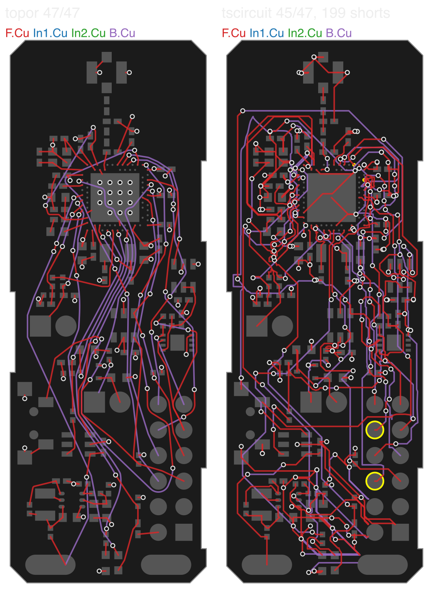

# topor vs tscircuit's autorouter

Routes a prepared topor case (`model.json`) with tscircuit's autorouter (`@tscircuit/capacity-autorouter`, the
router behind tscircuit.com), and judges both engines' copper the same way.

| Script | Does |
|---|---|
| `to_srj.py` | model.json → tscircuit SimpleRouteJson (`srj.json`) and a sidecar (`srj-meta.json`) |
| `route.mjs` | runs the autorouter on an SRJ, with a time limit, network disabled |
| `from_srj.py` | tscircuit traces → gridroute `layout.json` (what `kicad_io.py export` reads) |
| `check_layout.py` | router-independent connectivity and clearance check of any layout.json against its model |
| `compare.py` | both engines on one case: topor via `topor_engine.py`, tscircuit via the three above; KiCad export, DRC and `accept.py` where the case has an `unrouted.kicad_pcb`; `check_layout.py` for both |
| `render_layout.py` | layout.json over the model's pads as SVG |

```sh
npm install @tscircuit/capacity-autorouter          # anywhere; point TSCIRCUIT_AUTOROUTER at the package
TSCIRCUIT_AUTOROUTER=/path/node_modules/@tscircuit/capacity-autorouter TOPOR=/path/to/topor \
  python3 bench/pcb/tscircuit/compare.py EXT_R6B --input CASE_DIR --out OUT --seconds 120 --tscircuit-seconds 1800
```

## How a board is given to tscircuit

The same board topor gets: every copper layer; every pad as an obstacle (rotated rectangles, circles); small
copper zones and fixed copper of their net; rule areas that forbid tracks (`tracks`/`vias` in the model are
KiCad's do-not-allow flags); edge graphics; the outline with the edge clearance; class widths per connection;
the default class clearance as `defaultObstacleMargin`/`minTraceToPadEdgeClearance` (tscircuit takes its trace
clearance from the latter); via size and hole rules. Coordinates are flipped to y up, so KiCad's orientations are
tscircuit's `ccwRotationDegrees`.

Planes: SimpleRouteJson has no plane drop. Each SMD pad of a plane net becomes a two-point connection from the
pad to the same place on its plane layer (inside the net's pour, outside fill keepouts), so the router has to
bring a via down. Pours are copper-pour obstacles of their net; the rest of a plane layer is a pour of no net, so
no signal runs there. On the way back, a plane net's wires on its own plane are left to the pour (KiCad refills
it on export); only the via counts.

Not representable, listed in `srj-meta.json`: per-class clearance (the default is global; pads with a larger
clearance are grown by the difference), via-only keepouts, per-layer widths and layer restrictions, neck-downs,
RF single-layer nets, differential pairs. All of these make topor's task harder, not tscircuit's.

## Results (4 November 2026)

topor 5067f98 (Metal, M3 Max); tscircuit `@tscircuit/capacity-autorouter` 0.0.1038, default pipeline
(`AutoroutingPipelineSolver` = `AutoroutingPipelineSolver9_PreloadedTraceGraph`), 1800 s limit, Node 24.
Connectivity and clearance columns are `check_layout.py`; KiCad columns are native DRC against the stripped
input's baseline (`accept.py`). dut-pi has no KiCad board matching its model, so it has only the checker.

| Board | Engine | Time | Nets complete | Clearance (checker) | Vias | Track mm | KiCad |
|---|---|---|---|---|---|---|---|
| 1BP (4 L, 2 planes, 47 nets) | topor | 5.4 s | 47/47 | 0 | 113 | 717 | 0 unconnected; 3 new starved thermals (inherent to the board) |
| | tscircuit | 182 s | 45/47 | 2848 | 279 | 1241 | 3 unconnected; new errors: 199 shorts, 500 clearance, 202 hole clearance, 15 crossing tracks, 10 edge clearance |
| EXT (6 L, 3 plane layers, 119 nets) | topor | 52 s | 119/119 | 2 drill-drill (KiCad adds no new error) | 290 | 2625 | passes: 0 unconnected, no new errors |
| | tscircuit | fails at 228 s | none routed | – | – | – | – |
| dut-pi (6 L, 2 planes, 363 nets, 2250 pads) | topor | 124 s | 357/363 | 0 | 1048 | 10820 | (no KiCad board) |
| | tscircuit | fails at 25 s | none routed | – | – | – | – |

- **1BP**: tscircuit finishes and reports itself solved, but its copper does not hold the rules it was given.
  Its traces and vias clash with each other (in the checker: track-track 425, track-via 951, via-via 188). Most
  KiCad clearance gaps are 0.04-0.146 mm against 0.15 mm. Half of the track-via conflicts are on a layer outside
  the via's from/to span (a top→inner2 plane drop under a bottom track), although the input says
  `allowBlindAndBuriedVias: false`. Two nets stay open. It also uses 2.5x the vias and 1.7x the track length.
- **EXT**: `portPointPathingSolver` runs out of iterations ("CJ ran out of iterations") after 4 million steps.
- **dut-pi**: `NetToPointPairsSolver2_OffBoardConnection` does one iteration per connection but keeps the generic
  cap of 1000; the board has 1031 connections (361 nets, 670 plane drops), so it fails before routing.
  `route.mjs --lift-pair-cap` raises that one cap at runtime; it was not used for these results.


