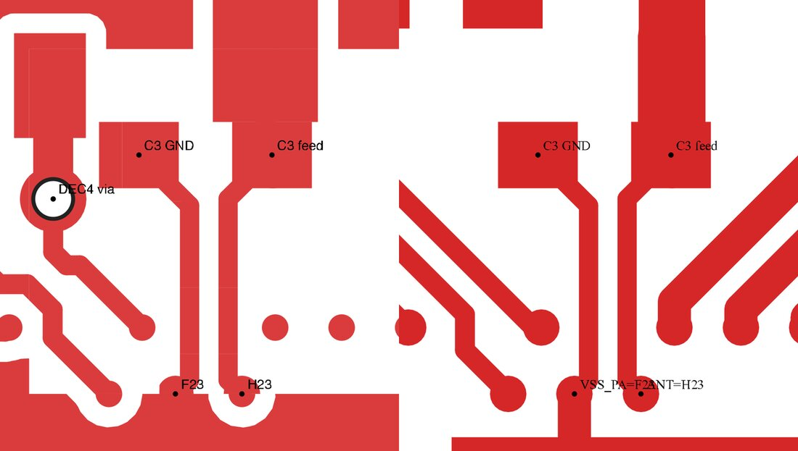
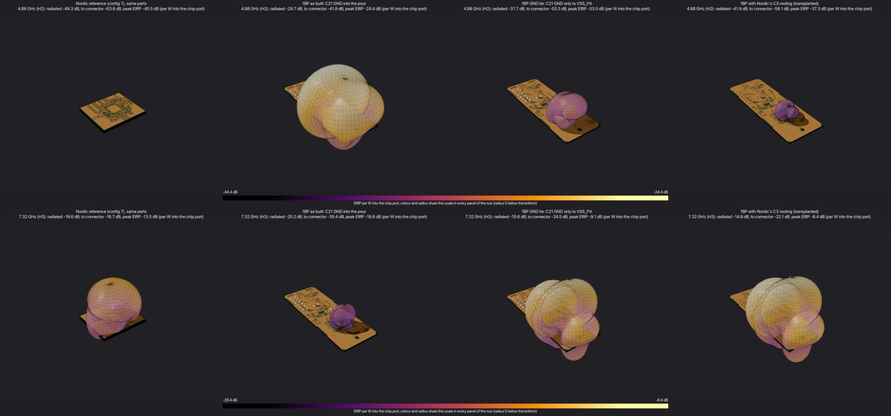
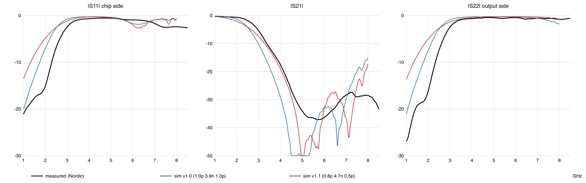
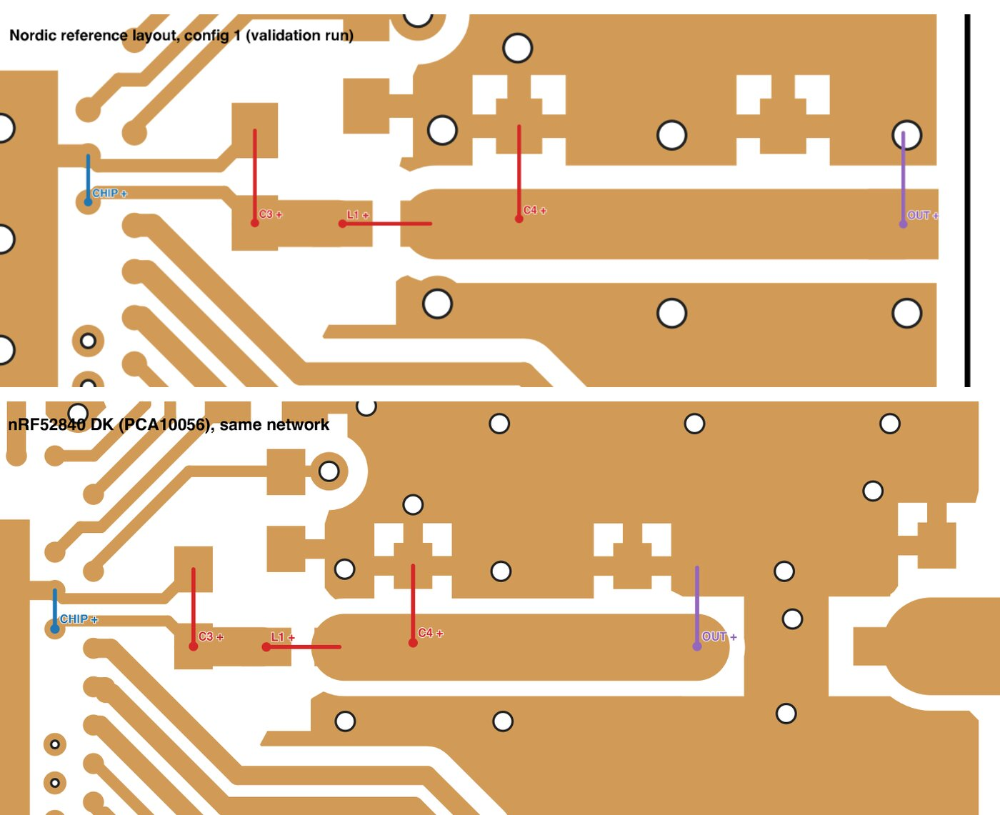
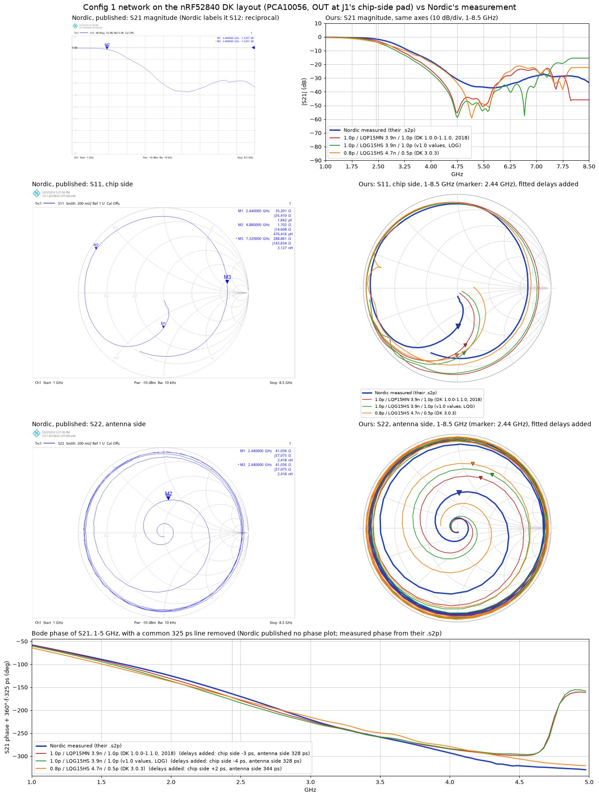
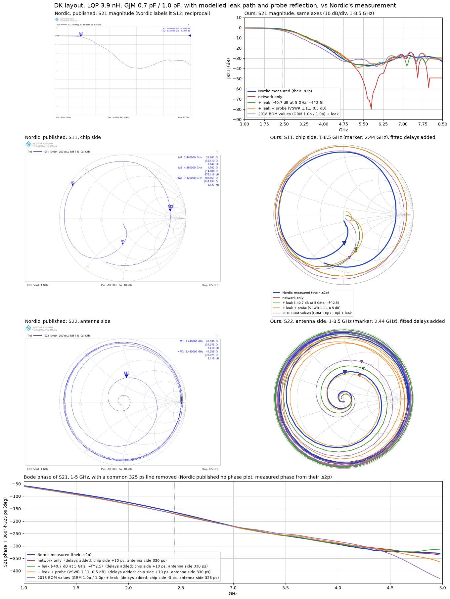

# 1BP RF frontend: findings from fieldsolve (Nov 2026)

1BP_mini R6B: nRF52840 (aQFN73), RF pin H23, a four-part ladder C21 1.0 pF shunt, L4 4.7 nH series, C18
1.2 pF shunt, L3 2.2 nH series, then the u.FL J1. These are exactly the values of Nordic's
four-component reference, configuration 7. The question was whether the 1BP layout of that network is
faulty compared with Nordic's.

## Summary

- **One real deviation from Nordic's layout: how C21 is grounded.** Nordic grounds the first shunt
  capacitor (their C3) only through its own trace, back to the chip's VSS_PA ball, alongside the ANT
  trace. Nothing else connects to its ground pad. 1BP floods C21's ground pad into the top ground pour.
- **That costs about 12-15 dB of 2nd-harmonic suppression in the model.** With identical parts and
  identical modelling, 1BP as built conducts and radiates about 20 dB more H2 than Nordic's reference.
  With Nordic's C21 routing transplanted from their Gerbers, the gap drops to 4-7 dB. The rest is the
  remaining layout (L4/C18/L3, the u.FL, a 0.8 mm board against 1.6 mm).
- **The H2 conclusion is robust.** It holds whether the chip's harmonic output is taken as a 50 ohm
  source, a voltage source or a current source.
- **The H3 numbers are not reliable for the tight-loop layouts, and are probably pessimistic** (see
  below). Don't use them to choose between layouts.
- **The model now agrees with Nordic's measurement to about 1 dB in band.** Nordic's 2018 measurement
  is most likely of an nRF52840 DK, whose 2018 revisions carry 1.0 pF / 3.9 nH / 1.0 pF with a
  thin-film Murata LQP15MN inductor. Modelled with that inductor, on the DK's own layout, the in-band
  gap halves and H3 matches. The roll-off still sits 5-9 % low (see Validation).
- **Thin-film inductors would move 1BP's in-band match toward the chip's target load,** at a cost of
  about 9 dB of H2 (see "Thin-film inductors on 1BP"). The LQP15MN is discontinued. LQG15HS 4.3 nH +
  1.6 nH reproduces most of the in-band effect with parts in production.
- **The inner-layer keep-out under the ladder is not a fault.** Nordic's reference does the same.
- **Recommendation for the next revision:** copy Nordic's C21 routing exactly: the isolated ground pad
  and the return trace to F23 alongside the ANT trace (figure below). Then check on hardware:
  conducted H2/H3 at J1 with a spectrum analyser at the TX power you use (Nordic measured about -58 to
  -61 dBc at H2), and the network from the ANT pad with a VNA, chip removed, as Nordic measured theirs.

## What was compared

All on the whole board, from Gerbers. Every case uses the same fitted parts as measured Touchstone models:
Murata GRM1555C1H1R0 (1.0 pF), LQG15HS4N7B02 (4.7 nH), LQG15HS2N2B02 (2.2 nH) and Yageo
CC0402BRNPO9BN1R2 (1.2 pF). Nordic's BOM names only values. The cases:

1. **Nordic reference, configuration 7**, from `nrf52840-qiaa-reference-layout-1_3.zip`. Altium Gerbers
   with no nets: ports placed by coordinate, the 13 decoupling capacitors as 30 mOhm resistors, the
   stack-up taken from the `.PcbDoc`.
2. **1BP as built**: C21's ground flooded into the pour.
3. **1BP, hand-made tie**: C21 mirrored, its ground pad isolated, and a hand-drawn 0.15 mm trace to F23.
4. **1BP with Nordic's C3 routing transplanted.** Nordic's top copper from the ANT ball to C3 is rotated
   onto 1BP. The two boards share the package and the feed handedness, so Nordic's VSS_PA ball lands
   exactly on 1BP's F23. Over the area from the chip edge to just past C3, 1BP's pour and ground vias are
   removed (Nordic has none there). 1BP's other nets (DEC3/DEC4/DEC5, the DEC4 via) are kept.

Model settings, the same for every case:
- 0.05 mm mesh along the RF path, graded outside it;
- wideband FR4 (Debye fit, tan delta 0.015, flat over 0.3-10 GHz);
- far field from a Huygens box in 12-15 mm of air;
- each part a measured model terminating its own EM port (`fieldsolve cosim`);
- harmonics given per watt into the chip port.

## Results

| per W into the chip port | Nordic ref | 1BP as built | hand tie | Nordic routing transplanted |
|---|---|---|---|---|
| H2 radiated / to connector | -49.3 / -63.8 dB | -29.7 / -41.8 dB | -37.7 / -53.3 dB | -41.9 / -58.1 dB |
| H3 radiated / to connector | -18.6 / -16.7 dB | -25.2 / -39.4 dB | -15.6 / -24.5 dB | -14.8 / -22.1 dB |
| chip-side impedance at H3 | 3.1 + j3.6 ohm | 5.5 + j91 ohm | 8.4 + j0.6 ohm | 11.2 + j1.5 ohm |
| chip-side impedance at 2.44 GHz | 12.8 - j45.5 ohm | 45.6 - j52.8 ohm | 22.9 - j50.7 ohm | 23.4 - j55.4 ohm |

H2 relative to the reference holds under each assumption about the chip's harmonic output. Radiated
per unit pin voltage: as built +19 dB, transplant +6 dB. Per unit pin current: +20 dB and +8 dB.

### Why the H3 numbers are unreliable

The reference, the hand tie and the transplant all have a short C3 ground loop. Its series resonance
falls near 7.3 GHz in the model, so the chip sees close to a short at H3. Above that frequency the
shunt capacitors are past their self-resonance, and the ladder's transfer rises steeply:

| chip -> connector, dB | 6.6 GHz | 6.9 | 7.1 | 7.32 | 7.5 | 7.7 | 7.9 |
|---|---|---|---|---|---|---|---|
| Nordic reference | -45.1 | -29.3 | -22.4 | -16.6 | -12.3 | -9.8 | -6.6 |
| 1BP as built | -46.0 | -41.7 | -39.9 | -39.4 | -40.4 | -42.1 | -36.0 |
| transplant | -42.9 | -31.5 | -24.9 | -22.0 | -20.7 | -17.5 | -15.2 |

- **That is 4-5 dB per 100 MHz at H3.** A frequency-scale error of a few percent moves the H3 result by
  tens of dB.
- **The model's frequency scale is uncertain by several percent.** Against Nordic's measurement, the roll-off
  matches within 1.4 % with the v1.1 values but sits 11-13 % low with v1.0 (Validation). A 10 % shift
  at 7.32 GHz would make the board behave like the model near 6.6 GHz: 25-30 dB better.
- **Copper loss blunts the resonance.** These runs had no copper loss; the model has it now, and it makes
  nulls and traps shallower by a few dB. Near the trap the result also changes by several dB with the
  mesh (see Validation).
- **"Per W into a 50 ohm port" exaggerates a near-short load.** The chip's real behaviour at H3 is
  unknown.
- **The measured data agree.** Nordic measured -48 to -51 dBc of H3 at their connector, which is far
  lower than the model's reference transfer would imply.

1BP as built does not sit on such an edge (flat around -40 dB), so its H3 figure is the trustworthy one.

## Validation against Nordic's measurement

Nordic's matching-network data (`nRF52840 QIAAC0 matching network`, 2018) holds a measured two-port, chip
side to antenna side. Its harmonic rejection (H2 -32.5 dB, H3 -28 dB) points to the three-part network,
so configuration 1 was simulated with both of Nordic's value sets and compared on magnitudes. Magnitudes
do not depend on the measurement's offset reference planes.

- **The shape matches:** low-pass, the H2 null, total reflection at the harmonics.
- **Which value set was measured matters.** The edges below are where |S21| first falls through each
  level:

  | | -3 dB | -10 dB | -20 dB | S21 at H2 / H3 |
  |---|---|---|---|---|
  | measured | 2.73 GHz | 3.38 GHz | 4.15 GHz | -32.5 / -28 dB |
  | model, v1.0 (1.0p 3.9n 1.0p) | 2.38 | 3.04 | 3.68 | -62 / -24 dB |
  | model, v1.1 (0.8p 4.7n 0.5p) | 2.28 | 3.33 | 4.13 | -37 / -37 dB |

  - With v1.0 the model's roll-off sits 11-13 % low. That was the origin of the earlier "10-15 % low"
    figure.
  - With v1.1 the -10 / -20 dB edges are within 1.4 % and H2 is close. That first suggested the measured
    board carried v1.1. The board history below points instead to v1.0 values with a thin-film inductor,
    which fits better overall. The measured H2 is probably a setup floor, so H2 is not evidence.
- **The in-band match is off with either set.** At 2.44 GHz the model gives S11 / S21 of about -3 / -3.5 dB,
  against -7.8 / -1.5 dB measured. That is the -3 dB edge's 15-20 % offset in the table.

**What was ruled out (Nov 2026).** Each candidate cause was added to the model or tested separately:

| change to the config 1 model (v1.0 parts) | S11 / S21 at 2.44 GHz | rms error 1-8 GHz, \|S21\| | S21 at 4.88 / 7.32 GHz |
|---|---|---|---|
| as first simulated | -3.0 / -3.7 dB | 10.5 dB | -49.5 / -22.9 dB |
| + copper loss (35 um, 1 um roughness) | -3.1 / -3.8 dB | 10.2 dB | -49.4 / -23.2 dB |
| + part bar de-embedding (0.06-0.11 nH per port) | -3.4 / -3.5 dB | 9.4 dB | -51.5 / -24.9 dB |
| same, 0.035 mm mesh instead of 0.05 mm | -3.4 / -3.5 dB | 11.2 dB | -47.6 / -24.0 dB |
| measured | -7.8 / -1.5 dB | | -32.5 / -27.9 dB |

- **Copper loss is real but small in band.** Traces, pads and planes now have a skin-effect surface
  impedance. That adds about 0.1 dB in band and makes the nulls shallower. It does not move the cutoff.
- **Part losses are already in.** The vendor files are measurements of the mounted parts, so their ESR and
  Q are included. Losses in the pads and traces under the parts are now covered by the copper model.
- **Port-bar double counting is real but small.** Each part sits on a copper bar across its pad gap, and
  the vendor data already contains the body's inductance across that gap. Removing the bar's partial
  inductance (0.06-0.11 nH here, from its geometry) improves the fit slightly.
  - A free fit wanted about 0.3 nH per part plus 0.6 nH at the output port. That is 3-5x more than the
    geometry gives, and even then it reached only 4 dB rms error.
- **The mesh is converged in band.** 0.035 mm cells give the same in-band result as 0.05 mm.
- **Near the harmonic nulls the results are not converged.** H2 and H3 move by 1-6 dB between the two
  meshes. That is a further reason to treat the modelled harmonic levels near traps as uncertain.
- **An independent solver agrees.** openEMS, given exactly the structure fieldsolve simulates, matches
  fieldsolve's S-parameters within 0.11 dB and 0.8° at 2.44 GHz, and within 1.5° of phase up to 8 GHz
  (constant-εr FR4, no copper loss, both codes). With Nordic's parts on openEMS's 5-port, S11 / S21 at
  2.436 GHz are −3.34 / −3.33 dB, against fieldsolve's −3.27 / −3.45 dB. The low-pass edge moves by
  0.6 %. A 10-15 % frequency-scale error is not in the solver.
  - Both codes share the model's conventions: zero-thickness copper and the stack-up as given. Real 35 um
    copper on a 70 um prepreg adds sidewall capacitance, which would lower the frequencies further, not
    raise them.
- **The stack-up is not the cause.** The top prepreg was varied: εr 4.2 instead of 4.8, and 0.1 or
  0.2 mm instead of 70 um (core thinned to keep 1.583 mm). In-band S11 / S21 moved by at most
  0.5 dB (v1.1, 0.2 mm: -3.4 / -3.2 dB), and the roll-off edges by about 1 %. The inner layer is cut out
  under the ladder, so the RF copper hardly sees the prepreg.
- **The test fixture explains the phase but not the magnitudes.**
  - The measured phase slopes put about 320-340 ps of extra line on the antenna side and none on the
    chip side (-30 to +20 ps). That looks like a coax pigtail or SMA launch.
  - A 50 ohm line of that length cuts the complex error from 0.83 to 0.2. It cannot change any magnitude.
  - Launches (shunt C, series L, including negative L to de-embed port loops), line impedance and loss
    were fitted within physical bounds. The best result reached S21 of only -2.4 dB at 2.44 GHz, with the
    parameters pinned at their bounds.
- **Nordic's measurement looks like the bare parts.**

  | v1.1, 2.44 GHz | S11 | S21 |
  |---|---|---|
  | measured | -7.8 dB | -1.5 dB |
  | Murata parts, no layout | -7.0 dB | -1.25 dB |
  | Murata parts on the layout | -2.8 dB | -3.7 dB |
  | ideal lossless parts on the layout | -3.4 dB | -2.8 dB |

  - The bare layout is benign: with L1 shorted and the capacitor ports open, S21 is -0.27 dB.
  - The penalty appears only with the parts in place, and as much with ideal parts as with vendor ones.
    At the chip side it is equivalent to about 1 pF of extra shunt capacitance, which comes mostly
    from the trace length between and beyond the parts.
  - So either Nordic's measured network does not include this layout's traces (for example a separate
    fixture de-embedded to the parts), or the model overstates the effect of placing parts on it. The
    data here cannot tell which.

### The measured board was most likely a 2018 nRF52840 DK

The PDF that ships with Nordic's `.s2p` is a bench report dated 2018-10-03. It shows VNA and spectrum
analyser screenshots only: the impedance seen from the antenna connector with the chip in place
(powered off, RX, TX at 0/4/8 dBm), then the 2-port with port 1 on the chip side. Every trace header
reads "Cal Offs", an offset correction that removes line delay but not trace parasitics between the
parts. So it is a measurement of a real board with its layout, not a layout-free network.

The nRF52840 DK (PCA10056) fits:

- **Same network, same copper.** C3 0.8 pF, L1 4.7 nH and C4 0.5 pF on DK 3.0.3 (2024) sit in the same
  places as on the reference layout, with the same trace widths and the same C3 return trace to
  VSS_PA. The top prepreg is 75 um on a 1.2 mm core, against the reference layout's 70 um on 1.3 mm.
  The inner layer is cut out under the ladder on both.
- **Different parts in 2018.** The DK's RF parts by revision (BOM date). The RF copper is the same
  throughout:

  | DK hardware files | C3 / L1 / C4 |
  |---|---|
  | 1.0.0, 1.1.0 (Mar / Dec 2018) | 1.0p / Murata **LQP15MN3N9B02D** / 1.0p |
  | 2.0.0, 2.0.1, 2.1.0 (Jul 2019 - May 2021) | 0.8p / **LQP15MN4N7B02D** / 0.5p |
  | 3.0.0 (Nov 2021) | Murata GRM1555C1HR80WA01D / LQP15MN4N7B02D / Murata GJM1555C1HR50WB01 |
  | 3.0.1, 3.0.2, 3.0.3 (May 2022 on) | 0.8p / **LQG15HS4N7B02D** / 0.5p |

  - The measurement (2018-10-03) falls in the 1.x era: v1.0 values with the thin-film 3.9 nH.
  - v1.1 (0.8p / 4.7n / 0.5p) was designed around the thin-film LQP 4.7 nH, not the LQG.
  - The LQG replaced the LQP in May 2022, ahead of Murata's last-order date (September 2022), with no
    retune. At 2.44 GHz the LQG15HS4N7 acts as 5.29 nH, against 4.58 nH for the LQP15MN4N7.
  - Only 3.0.0 names the capacitors. Every other revision gives value, dielectric and tolerance only.
- **Measured at J1.** The DK's only RF access point is J1, a Murata MM8130-2600 switch connector.
  Inserting the probe disconnects the PCB antenna and taps the chip side of the network. A probe plus
  adapter fits the ~330 ps left on port 2. A coax soldered to the ANT pad, with the chip removed and a
  port extension, fits the ~0 ps on port 1. A separate test board with an SMA would look much the
  same, but would carry the same copper.

The LQP15MN behaves quite differently from the LQG15HS used before:

| at 2.44 GHz | effective L | Q | self-resonance |
|---|---|---|---|
| LQP15MN3N9B02 (thin film) | 3.66 nH | 37 | above 8 GHz |
| LQG15HS3N9B02 (multilayer) | 4.29 nH | 43 | about 7 GHz |

The DK layout was simulated whole (18.8 M cells), with ports placed as on the reference layout and OUT
on J1's chip-side signal pad against J1's ground pad:

| config 1, cosim | S11 / S21 at 2.44 GHz | \|S21\| edges -3 / -10 / -20 dB | S21 at H2 / H3 | rms error 1-6 GHz |
|---|---|---|---|---|
| measured | -7.8 / -1.5 dB | 2.73 / 3.38 / 4.15 GHz | -32.5 / -27.9 dB | |
| DK, 1.0p / LQP15MN 3.9n / 1.0p (2018 parts) | -4.3 / -2.6 dB | 2.48 / 3.12 / 3.79 | -48.0 / -22.8 dB | 3.4 dB |
| DK, 1.0p / LQG15HS 3.9n / 1.0p | -3.2 / -3.6 dB | 2.34 / 3.02 / 3.69 | -51.1 / -29.0 dB | 4.2 dB |
| DK, 0.8p / LQG15HS 4.7n / 0.5p (DK 3.0.3) | -2.9 / -3.7 dB | 2.28 / 3.27 / 4.11 | -37.8 / -24.0 dB | 4.4 dB |
| reference layout, 2018 parts | -4.5 / -2.5 dB | 2.51 / 3.16 / 3.78 | -54.5 / -27.2 dB | 3.5 dB |

- **The 2018 inductor is the biggest single improvement found.** It halves the in-band S21 gap and
  brings the -3 dB edge from 13 % low to 9 % low.
- **The DK and reference layouts give the same answer** (within 0.2 dB in band and 1 % on the edges),
  as their copper suggests.
- **J1's own capacitance does not explain the rest.** A lumped shunt C (0-1 pF) and series L
  (0-1 nH) at OUT, standing for the connector's internal contact and the probe tip, were fitted on
  top. Any shunt C makes the match worse, and the best fit (0.17 pF with 0.46 nH, about neutral) leaves
  the error unchanged. Murata's VSWR spec (1.3 to 6 GHz) bounds such a capacitance to about 0.15 pF
  anyway. Murata publishes S-parameters for the connector only behind a member login.
- **The probe can't explain it either.** J1's mating probe is Murata's MM126036 (SMA to SWF). Murata
  gives no separate spec. A reseller lists VSWR up to 1.6 to 3 GHz and loss up to 0.6 dB. If the
  calibration ended at the SMA, the probe is in the data. At its worst phase, a lossless reflection of
  that size could move the 2.44 GHz point from -4.2 / -2.7 dB to -6.4 / -1.65 dB. But one reflection
  at a fixed delay ripples with frequency. Fitted over 1-4 GHz (size, phase, delay 0-450 ps, loss),
  the best case is VSWR 1.13 and improves the rms error only from 2.8 to 2.5 dB. The roll-off offset is
  a broadband shift, not a ripple.
- **The measured stopband has a floor the models lack.** From 4.5 to 6 GHz Nordic's |S21| is flat near
  -36 dB, where every model dips to -45 to -60 dB. A smooth floor like that is typical of leakage around
  the network in the test setup, such as probe or cable coupling. It also explains why the measured H2
  (-32.5 dB) is far shallower than the models'. So measured H2 should not be used to pick a value set.
- **The phase agrees** within 10-20° up to 4 GHz once the fitted plane delays are added (chip side
  -3 ps, antenna side 328 ps for the 2018 parts).
- **The capacitors are generic in every DK revision.** The BOMs give value, dielectric and tolerance
  only ("1.0pF NP0 ±0.1pF" in 2018), with no manufacturer. Sensitivity on the DK model with the 2018
  inductor:

  | C3 / C4 (Murata GRM1555, B tolerance) | S11 / S21 at 2.44 GHz | edges -3 / -10 / -20 dB | rms 1-6 GHz |
  |---|---|---|---|
  | 1.0 / 1.0 pF (nominal) | -4.3 / -2.6 dB | 2.48 / 3.12 / 3.79 GHz | 3.4 dB |
  | 0.9 / 0.9 pF (tolerance edge) | -4.9 / -2.2 dB | 2.56 / 3.28 / 3.96 | 2.6 dB |
  | 0.8 / 0.8 pF (beyond tolerance) | -5.5 / -1.9 dB | 2.65 / 3.43 / 4.19 | 2.1 dB |
  | measured | -7.8 / -1.5 dB | 2.73 / 3.38 / 4.15 | |

  The roll-off lands on the measured one with about 0.2 pF less at each shunt position. That is
  beyond the parts' tolerance. So either the real parts plus their pads act smaller than Murata's
  fixture data suggests, or the model carries about 0.15-0.2 pF too much shunt capacitance per node.
  This is consistent with the "layout penalty" found earlier.
- **Capacitors that are worse above 4 GHz make it worse, not better.** Synthetic 1.0 pF parts
  (series R-L-C) on the DK model with the 2018 inductor. Murata's GRM1555C1H1R0 fits as ESL 0.45 nH,
  self-resonance 7.5 GHz, ESR about 0.8 ohm, and the synthetic copy reproduces it.

  | 1.0 pF, ESL / ESR | S11 / S21 at 2.44 GHz | edges -3 / -10 / -20 dB | S21 at H2 / H3 | 4.5-6 GHz mean |
  |---|---|---|---|---|
  | measured | -7.6 / -1.6 dB | 2.73 / 3.38 / 4.15 GHz | -32.7 / -27.8 dB | -34.5 dB |
  | 0.45 nH / 0.8 ohm (Murata-like) | -4.2 / -2.7 dB | 2.48 / 3.13 / 3.80 | -48.4 / -23.1 dB | -45.2 dB |
  | 0.8 nH / 0.8 ohm | -3.6 / -3.3 dB | 2.41 / 2.96 / 3.47 | -39.4 / -19.4 dB | -32.1 dB |
  | 1.2 nH / 0.8 ohm | -2.8 / -4.2 dB | 2.32 / 2.78 / 3.18 | -21.2 / -17.5 dB | -18.5 dB |
  | 0.45 nH / 8 ohm | -5.5 / -4.2 dB | 2.26 / 3.01 / 3.75 | -36.4 / -23.7 dB | -34.5 dB |
  | 0.2 nH / 0.8 ohm | -4.5 / -2.5 dB | 2.53 / 3.28 / 4.07 | -36.0 / -28.3 dB | -39.5 dB |

  - **Higher ESL** pulls the roll-off down and raises the stopband. That is the opposite of the
    measurement.
  - **High ESR** (8 ohm) reproduces the flat stopband floor, but costs 1.5 dB in band, and the measured
    in-band loss is low. So the floor is not lossy capacitors either.
  - **Lower ESL** helps. At 0.2 nH the -10 / -20 dB edges come within 2-3 % and H2 / H3 within
    1-3 dB. That is less ESL than a mounted 0402 usually has. So more likely each shunt branch in
    the model carries about 0.25 nH too much, or that the parts are better than Murata's GRM data.
  - **Shunt-measured data doesn't show lower ESL.** Murata's "shunt mode" files (product API,
    `connectionType=shunt`) are the same impedance as the series files, converted, so they add no
    information. Johanson publishes genuinely shunt-measured data for its 0402 high-Q R07S
    (HP 8720C, shunt-through fixture, TRL*, 2003). Fitted with a part model plus the leftover
    reference-plane offset (about 12 ps per side), they give ESL 0.48-0.50 nH for 0.8-1.2 pF. That's
    no lower than Murata's 0.45 nH, and it includes the fixture's ground return. So genuinely
    shunt-mounted parts don't explain the extra reactance. Series data with the ground path modelled
    in EM, as used here, is the consistent choice. Johanson's "series" R07S files are circuit-model
    output with their test board embedded (16 x 21 mil pads on RO4350B GCPW), and aren't usable
    as-is.
  - **High-Q GJM capacitors do help, through their lower ESL** (GJM1555C1HR50WB01: 0.29 nH, against
    about 0.45 nH for the GRM). On the DK model with LQP 3.9 nH: GJM 1.0p / 1.0p gives rms 2.8 dB
    (GRM 3.4 dB). GJM 0.8p / 0.8p gives 2.2 dB, S11 / S21 -5.4 / -1.8 dB, edges 2.69 / 3.50 /
    4.36 GHz and H3 -28.1 dB (measured -27.8 dB). The exact DK 3.0.0 parts (v1.1 with LQP 4.7 nH)
    fit worse (4.3 dB), so v1.1 is not what Nordic measured.
- **A free choice of part values points at LQP 3.9 nH with smaller capacitors.** 256 combinations on
  the DK model: C3 and C4 each 0.5-1.2 pF (GRM1555, B tolerance), L1 LQP15MN or LQG15HS at 3.9 or
  4.7 nH. Ranked by magnitude error over 1-6 GHz (S11, S21, S22):

  | C3 / L1 / C4 | rms | S11 / S21 at 2.44 GHz | edges -3 / -10 / -20 dB | S21 at H2 / H3 |
  |---|---|---|---|---|
  | measured | | -7.6 / -1.6 dB | 2.73 / 3.38 / 4.15 GHz | -32.7 / -27.8 dB |
  | 0.7p / LQP 3.9n / 0.9p (best) | 1.8 dB | -5.7 / -1.8 dB | 2.67 / 3.44 / 4.20 | -33.4 / -23.1 dB |
  | 0.8p / LQP 3.9n / 0.8p | 2.1 dB | -5.3 / -1.9 dB | 2.65 / 3.43 / 4.19 | -36.5 / -24.5 dB |
  | 1.0p / LQP 3.9n / 1.0p (DK 2018 BOM) | 3.4 dB | -4.1 / -2.7 dB | 2.48 / 3.12 / 3.79 | -47.6 / -22.8 dB |
  | best with LQG 3.9n (0.6p / 1.1p) | 2.5 dB | | | |
  | best with LQG 4.7n (0.5p / 0.8p) | 3.7 dB | | | |

  - All twelve best combinations use the LQP 3.9 nH. The inductor choice matters more than the exact
    capacitors.
  - The capacitor fit is degenerate: about 1.6 pF in total, split anywhere from 0.5/1.0 to 0.8/0.8.
  - A board with 0.8 pF parts is plausible. The report reads like bench work done while tuning, and
    v1.1's C3 is 0.8 pF. It is also consistent with the model carrying extra shunt reactance per node
    (above). The data cannot separate the two.
- **Smaller still overshoots.** High-Q GJM pairs with LQP 3.9 nH on the DK model: 0.7 / 1.0 pF and
  0.7 / 0.9 pF fit best (rms 2.0 dB, edges within 1-5 %, H2 within 2 dB). 0.7 / 0.7 pF pushes the
  -10 / -20 dB edges 11-12 % high and H2 to -24 dB (rms 3.1 dB). S11 at 2.44 GHz levels off near
  -6 dB however small the capacitors get, so the remaining S11 gap is not the capacitors.
- **The measurement setup, modelled.** Two additions to the network model, fitted to Nordic's
  magnitudes over 1-8.5 GHz (S11, S21, S22):
  - a **leak path** added to S21/S12: A·(f/5 GHz)^n with its own delay and phase, standing for coupling
    around the network (cables, probe, board radiation);
  - a **probe reflection** at port 2: a reflection of fitted size and phase at a fitted delay beyond
    OUT, plus loss, bounded at VSWR 1.6 and 0.6 dB.

  | GJM 0.7p / LQP 3.9n / GJM 1.0p on the DK | rms 1-8.5 GHz | S11 / S21 / S22 at 2.44 GHz | 4.5-6 GHz mean \|S21\| |
  |---|---|---|---|
  | measured | | -7.8 / -1.5 / -8.4 dB | -34.5 dB |
  | network only | 4.6 dB | -5.7 / -1.8 / -5.7 dB | -45.1 dB |
  | + leak (-40.7 dB at 5 GHz, rising as f^2.5) | 1.8 dB | -5.7 / -1.8 / -5.7 dB | -34.5 dB |
  | + probe only (VSWR 1.22, no loss) | 4.3 dB | -6.6 / -1.5 / -6.8 dB | -45.5 dB |
  | + leak + probe (VSWR 1.11, 0.5 dB) | 1.4 dB | -5.2 / -2.5 / -8.0 dB | -33.6 dB |
  | 2018 BOM values (GRM 1.0p / 1.0p) + leak | 2.2 dB | -4.3 / -2.8 / -4.6 dB | -32.7 dB |

  

  - **A leak about 40 dB down at 5 GHz, rising roughly as f² to f^2.5, reproduces the stopband floor
    exactly.** It's invisible in band. Coupling that grows with frequency at that level is typical of
    cable-to-cable or probe radiation in a bench setup. That supports reading the measured H2
    (-32.5 dB) as the setup's floor.
  - **A modest probe reflection** (VSWR 1.1-1.2, within even the connector's own spec) can close S21
    at 2.44 GHz and half the S11 gap. But its parameters are poorly constrained, and it barely
    changes the error across the band. It's plausible, not demonstrated.
- **What is left:** S21 about 1 dB low and the roll-off 5-9 % low with the nominal 2018 parts, and
  about 0.3 dB / 1-5 % with 0.8 pF high-Q capacitors. The capacitors actually fitted, the probe, and
  any de-embedding Nordic did are unknown. The real validation is still a measurement of our own board, with known parts and a
  known reference plane: a VNA on the 1BP network with the chip removed.

## Thin-film inductors on 1BP

1BP's two inductors swapped for Murata LQP15MN thin-film parts, on the existing EM data with nothing else
changed. The target is the 35 - j35 ohm load implied by Nordic's measured network. S21 at the harmonics
is in a 50 ohm system.

| 1BP as built, L4 / L3 | chip sees at 2.44 GHz | \|Γ\| vs target | S21 at H2 / H3 |
|---|---|---|---|
| LQG15HS 4.7n / 2.2n (as fitted) | 38.6 - j69.7 ohm | 0.42 | -41.7 / -39.8 dB |
| LQP15MN 4.7n / 2.2n | 53.1 - j63.0 ohm | 0.35 | -32.7 / -36.0 dB |
| LQP15MN on L4 only | 68.9 - j55.5 ohm | 0.37 | -40.0 / -34.2 dB |
| LQG15HS 4.3n / 1.6n | 48.3 - j65.3 ohm | 0.37 | -34.7 / -47.2 dB |

- **The thin-film parts act as smaller inductors.** At 2.44 GHz LQP15MN 4.7n is 4.58 nH and 2.2n is
  1.83 nH, against 5.29 and 2.56 nH for the LQG15HS. That moves the match toward the target.
- **H2 gets about 9 dB worse** (12 dB with Nordic's C21 routing transplanted, where \|Γ\| goes from
  0.38 to 0.31 with LQP and 0.33 with LQG 4.3n / 1.6n).
- **The LQP15MN is end of life** (last order 2022-09, end of production 2023-09). Murata names the
  LQG15HS as the alternative. LQG15HS 4.3n + 1.6n, chosen to match the thin-film parts' effective
  inductance at 2.44 GHz, gives most of the in-band effect.
- With the model still about 1 dB pessimistic in band, trust the direction more than the absolute
  values, and measure before changing the BOM.
## Other findings along the way

- **In1 is the VCC2V4 plane.** Referencing a port to it, without its decoupling capacitors modelled, made
  the plane ring as a patch: spurious notches at 2.32, 2.95 and 7.55 GHz.
- **Nordic's 115.8 - j33.4 ohm is not the pin load.** It is a hot impedance measured from the connector
  with the chip transmitting. The load the chip is designed for is in Nordic's `.s2p` file (35 - j35 ohm
  at 2.44 GHz), within the uncertainty of their offset reference plane.
- **The board radiates more harmonic than reaches J1,** in every case, by 9-16 dB at H2. A radiated
  pre-scan is worth doing as well as the conducted check.

## Reproducing

The inputs and scripts were in the session scratchpad. To rebuild:

- **Models:** specs in the style of `1bp_board_ff_w2.json`, run with `fieldsolve run`, then
  `fieldsolve cosim` with `"farfield": true`.
- **Nordic reference:** the Gerbers plus a hand-written `.gbrjob` carrying the `.PcbDoc` stack-up; ports
  by coordinate.
- **Transplant:** Nordic's top layer dumped with `fieldsolve prims`, rotated by
  (u, v) -> (149.419 - v, -92.8695 + u) from Nordic's ANT ball at (2.751, 1.001), clipped, and appended
  to 1BP's top-layer Gerber as regions with X2 nets.
- **Figures:** `tools/blender_farfield.py` and `tools/render_farfield_panels.py`.
- **nRF52840 DK:** hardware files 3.0.3 from Nordic's DK download page (1.0.0 and 1.1.0 are still on the
  same server, unlisted). Gerbers `400236.GTL/G1/G2/GBL/GM1`, drills `400236-RoundHoles.TXT` (through)
  and `.TX1` (blind 1-2), and a hand-written `.gbrjob` from `400236_PCB_Laminate_Specification.pdf`.
  Pick-and-place coordinates equal Gerber coordinates. Six nearby decoupling capacitors as 30 mOhm
  resistors.
- **LQP15MN S-parameters:** discontinued, so not in Murata's library zip; the product API still serves
  them, at `pimapi.murata.com/public/api/pim/v1/characteristics/search/s-parameter?partNum=LQP15MN3N9B02%23&productCategoryId=inductor&languageRegion=en-eu`.
