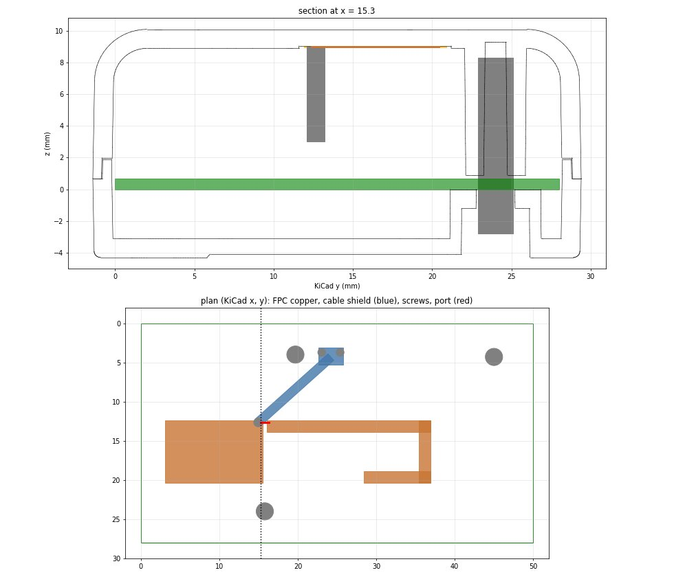
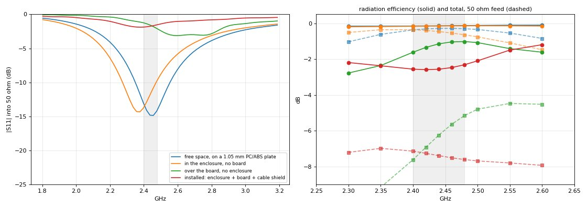
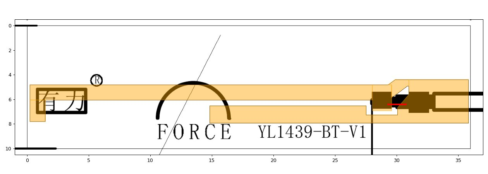
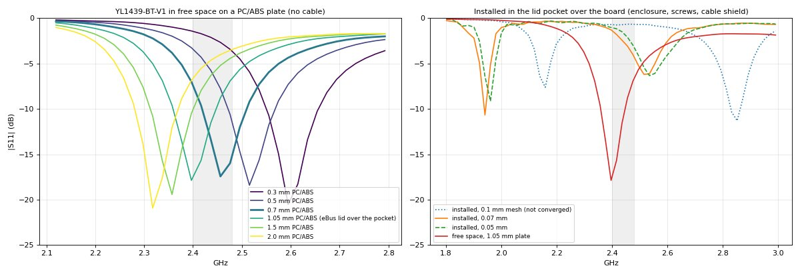
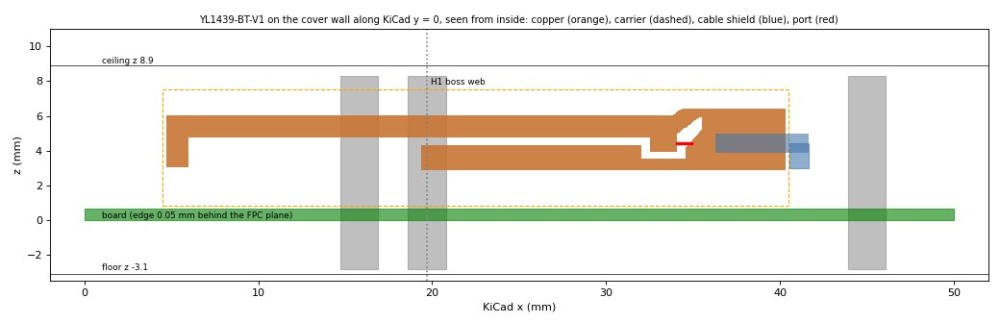
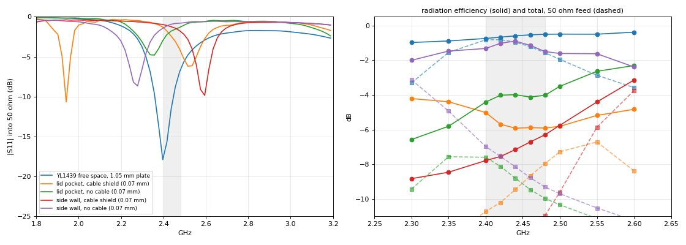

# eBUS_IF inline: FPC antenna in the lid pocket (fieldsolve, Nov 2026)

The eBUS_IF inline adapter (`p-hw` branch `claude/ebus-if-inline`, `Revision_7/eBUS_IF_inline`, draft A.4 at
81d5260c) has no PCB antenna. The nRF52840's configuration-7 front end ends in a u.FL (J3). The moulded
enclosure (`enclosure-moulded/`) puts an adhesive FPC antenna in a 0.15 mm pocket in the cover ceiling,
centred at KiCad x 20.0, y 16.4. The README specifies it as "34.9 x 9.0 x 0.1 mm, Molex 146153 class". Its
cable plugs into J3.

## Summary

- **With the FORCE YL1439-BT-V1, the FPC used on other boards, it is worse:** 26-45 % radiation efficiency
  in the pocket, and −7.5 to −11.6 dB in total from 50 Ω, depending on the cable. In free space on 1.05 mm of
  PC/ABS it is 85-89 %. The part appears tuned for about 0.7 mm of plastic. See
  [the YL1439 section](#the-force-yl1439-bt-v1-the-fpc-used-on-other-boards).
- **On the side wall beside J3, the YL1439 itself radiates 69-81 % without the cable.** But it is detuned to
  2-4 Ω, and the modelled cable route drags it down to 17-27 %. It needs a retune and a controlled cable
  route; see [the side wall](#the-yl1439-bt-v1-on-the-side-wall). The result is from a single mesh.
- **Johanson's 2450AT42E chip antenna** measures 21 % on a 50 × 30 mm evaluation board. It needs In1/In2
  cleared under it on this 4-layer board; see [the chip antenna](#a-chip-antenna-on-the-board).
- The rest of this summary is about the stand-in dipole first modelled for the "Molex 146153 class" part.
- **The pocket puts the FPC about 8.3 mm above the board's ground, parallel to it, and that wrecks it.**
  - The board is 50 × 28 mm, a 4-layer 0.8 mm board with ground on the inner layers, and it fills the
    enclosure. The FPC's copper sits at z 9.0, and the board's top copper at z 0.67.
  - In free space on a 1.05 mm PC/ABS plate, the stand-in FPC used here is 35 + j4 Ω at 2.44 GHz and
    radiates 97 % of what it accepts.
  - In the pocket, it is 9 + j46 Ω (S11 −1.8 dB) and radiates 55-62 % across 2.40-2.50 GHz.
  - Fed from 50 Ω, the total in band is −7.1 to −7.6 dB, against −0.3 dB in free space.
- **The board causes it; the plastic hardly does.**
  - With the enclosure but no board, the FPC detunes by about 60-80 MHz and still radiates 96-97 %.
  - With the board but no enclosure, its resistance falls to 5-10 Ω and its efficiency to 69-79 %.
  - It behaves like a low patch: its own image in the ground plane cancels most of its radiation
    resistance. The currents that remain are large, so the loss in the board's FR4 (tan δ 0.02) and
    copper, and in the plastic, takes a big share.
  - Its directivity rises from 1.9 dBi to 6.5 dBi, beamed up through the lid.
- **Rematching can't fix it.** A matching network retuned for 9 + j46 Ω would remove most of the mismatch.
  The radiation efficiency would still cap the total at about −2.1 to −2.6 dB, over a narrow band
  (R ≈ 9 Ω, so the matched bandwidth is small), and the mismatch through the 1.13 mm coax would add cable
  loss on top.
- **Placement is the lever.** An FPC needs clearance from ground planes; vendors typically ask for 10-20 mm
  or more, or for mounting perpendicular to the board. In this enclosure the board fills the plan, so a
  ceiling pocket has no ground-free area to use. Options to simulate next:
  - an end or side wall, perpendicular to the board;
  - a taller cover;
  - a PCB antenna in a ground-free strip at the board's end.

## Model

- **Board:** the A.4 Gerbers (`exports/fab/gerbers`), with the 4-layer stack-up from the job file. It uses
  `"preset": "antenna"` (surface-impedance copper, wideband FR4 loss, sub-cell edges, mesh refinement,
  the whole board).
  - Decoupling: every capacitor of 47 pF or more is a short (22 parts). The 12 pF crystal loads and the
    1-1.2 pF match are left open.
  - Chips (U4 nRF52840, U2, U5, U6, U1) have 3 pF on each signal pin.
  - The eBUS lines (EBUS_A, EBUS_B, TX_B) and CC_S are acknowledged as open. In use they run on into the bus
    cable, which isn't modelled.
- **Enclosure:** `build/asm-base.stl` and `asm-cover.stl` as dielectric bodies. The material is FR PC/ABS,
  with εr 2.9 and tan δ 0.008 assumed at 2.4 GHz (datasheets give 1 MHz values).
- **Screws:** the three ST2.2 screws (H1, H2, H3) are metal posts of radius 1.1 mm from z −2.8 to 8.3.
- **FPC:** a stand-in. Molex doesn't publish the copper pattern, so this is an off-centre-fed dipole of the
  same outline (34.9 × 9.0 mm).
  - A 13 × 8 mm shield-side patch at the left.
  - A 1.5 mm radiator arm along the edge nearer J3, folded up the right end and back 8.5 mm along the top.
    That return length tunes it to about 2.44 GHz on a 1.05 mm PC/ABS plate in free space, the vendor-style
    condition.
  - Copper at z 9.00 on a 0.1 mm polyimide carrier (εr 3.4, z 8.95-9.05) in the pocket.
  - Port: 50 Ω across the 0.5 mm feed gap.
- **Cable:** the shield of the 1.13 mm coax is modelled by its outer surface only. It rises from the FPC's
  shield pad to z 3.0, runs straight to the mated u.FL plug on J3, and drops to J3's ground pads. Without
  it, the installed results change by under 0.3 dB (see the table).
- **Mesh:** 0.1 mm over the FPC, and at most 0.4 mm over the enclosure. A finer-mesh check at 0.07 mm is
  below.
- **Solver features:** these runs use fieldsolve's new `"bodies"` (STL and box dielectrics, metal posts) and
  `"layers"` (copper off the board) keys; see [fieldsolve.md](fieldsolve.md#usage).

## Results

| Case | Z at 2.44 GHz | S11 at 2.44 | radiation efficiency 2.40 / 2.44 / 2.48 / 2.50 GHz | total from 50 Ω at 2.44 | peak directivity |
|---|---|---|---|---|---|
| free space, 1.05 mm PC/ABS plate | 35 + j4 Ω | −14.8 dB | 96.6 / 96.9 / 97.2 / 97.3 % | −0.28 dB | 1.9 dBi |
| enclosure, no board | 41 + j23 Ω | −11.8 dB | 96.3 / 96.6 / 96.8 / 96.8 % | −0.45 dB | 2.0 dBi |
| board, no enclosure | 5 − j21 Ω | −1.6 dB | 68.9 / 76.8 / 79.1 / 78.1 % | −6.3 dB | 6.6 dBi |
| **installed** (enclosure, board, screws, cable shield) | **9 + j46 Ω** | **−1.8 dB** | **55.5 / 55.5 / 58.8 / 61.8 %** | **−7.35 dB** | **6.5 dBi** |
| installed, no cable shield | 9 + j38 Ω | −2.0 dB | 52.3 / 52.7 / 56.1 / 59.3 % | −7.05 dB | 6.4 dBi |

**Two-mesh check.** The installed case at 0.07 mm cells (18.3 M cells) against 0.1 mm (10.0 M):

| | 2.40 | 2.44 | 2.48 | 2.50 GHz |
|---|---|---|---|---|
| Z, 0.1 mm | 8 + j35 | 9 + j46 | 10 + j57 | 11 + j63 Ω |
| Z, 0.07 mm | 8 + j31 | 9 + j41 | 10 + j52 | 10 + j58 Ω |
| radiation efficiency, 0.1 / 0.07 mm | 55.5 / 52.7 | 55.5 / 56.3 | 58.8 / 61.2 | 61.8 / 64.3 % |
| total from 50 Ω, 0.1 / 0.07 mm | −7.12 / −7.12 | −7.35 / −7.20 | −7.55 / −7.32 | −7.61 / −7.38 dB |

The conclusion holds on both meshes. The efficiency is mesh-sensitive by about ±3 points, and the
reactance by about 5 Ω.

## The FORCE YL1439-BT-V1 (the FPC used on other boards)

ShenZhen Powerful Technology's FPCs are marked "FORCE". Two are on file:
- the YL1439 2.4/5 GHz Wi-Fi V2, 46 × 10 mm and dual band, specified for Modbus_IF in
  `Revision_6/Modbus_IF/docs/manufacturing/original/KNA-019286R0_YL1439_antenna_spec.pdf`;
- the single-band **YL1439-BT-V1**, 36 × 10 mm, whose vendor AutoCAD drawing (Oct 2022) shows the copper
  outline. That drawing is `YL1439-BT天线-FPC.pdf` in Downloads.

The BT part is the logical one for a 2.4 GHz-only design. It is 0.5 × 0.4 mm larger than the pocket drawn for
the Molex part, so the pocket would grow to about 36.5 × 10.4 mm.

- **The pattern is a printed inverted-F.**
  - A 1.25 mm arm runs about 28 mm from an open end at the left (with a tab) to a feed pad.
  - A 0.5 mm bridge over a diagonal slot shorts the arm to the block where the cable lands.
  - A 1.4 mm ground strip runs back from that block.
  - The 1.13 mm cable (63 mm) leaves along the FPC's axis. The model's port spans the slot from the feed pad to
    the block.
- **No measurement of this part is on file**, so the model isn't validated. The Wi-Fi V2's report (62-81 %
  efficiency, 5.0-5.8 dBi peak gain) is a different pattern.
- **It is tuned for a thin plastic carrier.**
  - In free air (no cable) it sits at 2.85 GHz.
  - On a PC/ABS plate, it centres on the band with **about 0.7 mm** of plastic behind it: best match at
    2.46 GHz, VSWR ≤ 2 from 2.42 to 2.50 GHz.
  - Under the eBus lid's 1.05 mm (the 1.2 mm wall less the 0.15 mm pocket) it sits at 2.40 GHz. Each further
    0.5 mm lowers it about 40 MHz.
  - On the 1.05 mm plate it radiates 85-89 %, with a peak gain of about 1.5 dBi.
  - These free-space runs agree at 0.1 and 0.07 mm cells: the same best-match frequency (2.397 GHz), with
    the impedance within 1-3 Ω.
- **Installed, it radiates only 26-33 %.** These are converged numbers: 0.07 and 0.05 mm agree.

  | 0.05 mm mesh | 2.40 | 2.44 | 2.48 | 2.50 GHz |
  |---|---|---|---|---|
  | Z | 7 + j59 | 15 + j79 | 72 + j119 | 169 + j85 Ω |
  | S11 | −1.0 | −1.5 | −3.0 | −4.1 dB |
  | radiation efficiency | 32.9 | 31.6 | 28.3 | 27.3 % |
  | total from 50 Ω | −11.6 | −10.4 | −8.5 | −7.8 dB |

  - The antenna's own resonance moves up to about 2.5-2.55 GHz.
  - A sharp mode at 1.93-1.96 GHz (Q about 32) is still ringing when the runs stop, and the 0.05 mm run hit
    its 200 000-step limit.
  - The 0.1 mm installed run put the resonance near 2.15 GHz instead. **It isn't converged.** The 0.1 mm
    shortened-arm runs from the same mesh are void too.
  - The stand-in dipole above did agree between 0.1 and 0.07 mm.

- **The 1.93-1.96 GHz mode belongs to the cable.**
  - Without the cable shield (0.07 mm), it is gone. The antenna then resonates near 2.3 GHz and sees
    10 − j24 / 5 − j7 / 4 + j1 / 3 + j4 Ω at 2.40 / 2.44 / 2.48 / 2.50 GHz, radiating 36 / 40 / 40 / 45 %
    (total −7.5 to −10.1 dB).
  - That run agrees with the 0.1 mm one (9 − j18 / 5 − j5 Ω at 2.40 / 2.44 GHz), so the cable model is what
    needed the finer mesh: its strip runs 0.4 mm under the FPC.
  - The real cable's route sits between those two cases. Either way the YL1439 does worse here than the
    stand-in dipole (55-62 %). The pocket over the board's ground is still the problem; a thinner lid would
    only retune it.

## The YL1439-BT-V1 on the side wall

- **Placement:** on the cover's inner wall along KiCad y = 0, the J3 side.
  - The copper faces into the box at y −0.05, about 0.05 mm outside the board's edge plane.
  - The long axis runs along x from x 4.5. The 3.5 mm copper band is at z 2.9-6.4, so the arm is the part
    farthest above the board (z 4.8-6.0) and the ground strip the nearest (z 2.9-4.3).
  - The FPC's blank top margin would bend round the top fillet (inside radius 2.1).
  - The H1 boss's web (x 19.7) meets this wall, so a real FPC would need a notch in the web or a shift.
  - The cable shield runs along the FPC from the braid pad to past its end, down to z 3.0 at x 41, then
    straight to J3.
- **Model:** the copper is metal boxes standing vertically (`"metal": true`; lossless, no edge corrections),
  fed by a free-standing port (`"p0"`/`"p1"`) across the slot.
  - On a vertical 1.05 mm plate in free space this copy resonates about 2.5 % (60 MHz) above the horizontal
    sheet model. Read the frequencies below with that bias in mind.
  - Single mesh (0.07 mm), not yet checked on a finer one.

| 0.07 mm mesh | Z at 2.44 GHz | S11 at 2.40-2.50 | radiation efficiency 2.40 / 2.44 / 2.48 / 2.50 GHz | total from 50 Ω |
|---|---|---|---|---|
| lid pocket, cable shield | 26 + j81 Ω | −1.3 to −5.2 dB | 31.5 / 25.6 / 25.7 / 26.3 % | −7.4 to −11.0 dB |
| lid pocket, no cable | 5 − j7 Ω | −1.1 to −3.0 dB | 36.2 / 39.9 / 39.7 / 44.6 % | −7.5 to −10.1 dB |
| side wall, cable shield | 8 + j54 Ω | −1.0 to −2.2 dB | 16.7 / 19.3 / 23.5 / 26.6 % | −9.8 to −14.8 dB |
| side wall, no cable | 3 + j14 Ω | −0.8 to −1.4 dB | 73.7 / 81.3 / 70.8 / 69.0 % | −6.8 to −9.6 dB |

- **On the wall, the FPC itself radiates well: 69-81 % without the cable.** Standing beside the board edge,
  instead of over the ground plane, it isn't shorted out by its image.
  - Its resonance falls to about 2.25-2.3 GHz, and in band it sees only 2-4 Ω, so from 50 Ω almost
    everything reflects.
  - It would need a retune for this mounting: a shorter arm (the vendor's custom tuning), or a match at the
    FPC.
- **The modelled cable route spoils it: 17-27 %, with a cable mode at 1.70 GHz (Q about 26).** The shield
  runs 2.3 mm over the board from the wall to J3. In both placements the cable's outer surface is part of the
  antenna, so its route and length decide much of the result. A short, direct route along the wall to J3, or
  a ferrite or sleeve choke on the cable, are the obvious things to try.
- **Neither placement gives a usable antenna as the part comes.** The side wall is the better mounting
  (69-81 % against 36-45 % for the bare FPC) if the FPC is retuned and the cable route controlled.

## A chip antenna on the board

The chip antenna on file in p-hw is Johanson's **2450AT42E0100001E** (`docs/antenna/C17605137/`, LCSC
C17605137). It is a 5.0 × 2.0 × 1.5 mm "above metal" LTCC part for the centre of a board edge, and it needs no
ground clearance. The p-hw folder also holds VNA sweeps of it on three board shapes, but no efficiency
measurements.

- **Johanson's evaluation board is 50 × 30 mm,** about the eBus board's 50 × 28 mm.
  - Measured average radiated efficiency is **21 %**, average gain −5.0 dBi and peak gain −2.0 dBi.
  - Return loss is only 4.4 dB minimum over 2.40-2.48 GHz (S11 −5.7 / −11.3 / −5.7 dB at 2.40 / 2.44 /
    2.48 GHz), so it is narrow even with its match.
- **Its efficiency depends on the distance H to the metal under it.** Johanson's simulation on a 30 × 50 mm
  board gives 1.95 % at H = 0.12 mm, 29.2 % at 0.7 mm, 23.3 % at 1.5 mm and 21.6 % at 2.5 mm. A 1.1-2.5 mm
  variant, 2450AT42E010B001E, reaches 38-42 %.
  - On the eBus 4-layer board, In1 (ground) is 0.21 mm under the top copper, which would put it near the
    bottom of that table.
  - Clearing In1 and In2 under the chip moves the nearest metal to B.Cu, about 0.67 mm down, which is the
    29 % case.
- **It can't be modelled from first principles here.** The internal LTCC structure isn't published. A
  stand-in would have to be a lumped resonator on the pads, calibrated against the evaluation board's S11 and
  21 % efficiency, and that only transfers the board and enclosure effects. Johanson offers its CAD layout
  and tuning support on request.

## Caveats

- **The FPC is a stand-in.** A real Molex 146153 has its own pattern and tuning, and its measured
  impedance and efficiency on a ground plane would differ. The mechanism doesn't depend on the pattern,
  though: any small horizontal antenna 8 mm over a ground plane its own size loses most of its radiation
  resistance. The real part's datasheet clearance rules apply.
- **The cable is crude.** Only the shield's outer surface is modelled, along one route. A real cable's
  route, length and any ferrite change the common-mode currents.
- **Not modelled:** the eBUS cable on J1, the plug's metal contacts, and the parts' bodies on the board
  (the inductors L1-L3, the electrolytics C7/C8, SW1). Only their pads are there.
- **The enclosure material is estimated:** εr 2.9, tan δ 0.008.
- **The matching network isn't included.** These are antenna-alone results at the FPC's feed.

## Reproducing

`tools/ebus_fpc_specs.py` writes the specs (run it from a directory holding the board's Gerbers as `gbr/`
and the air "dummy" board as `dummy_gbr/`; see its docstring):

- `python3 ebus_fpc_specs.py free fpc_free 8.5 ff`
- `python3 ebus_fpc_specs.py inst fpc_inst 8.5 ff` (`nocable` for the run without the shield)
- The enclosure-only and board-only cases drop the board or the `base`/`cover` bodies from those specs.
