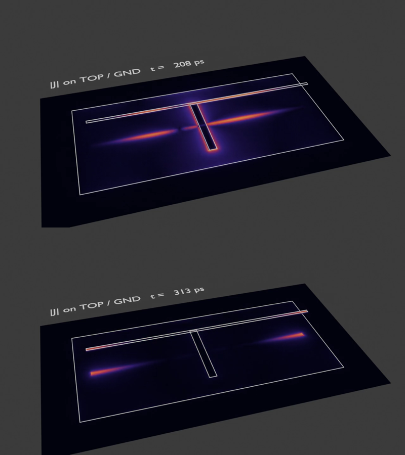
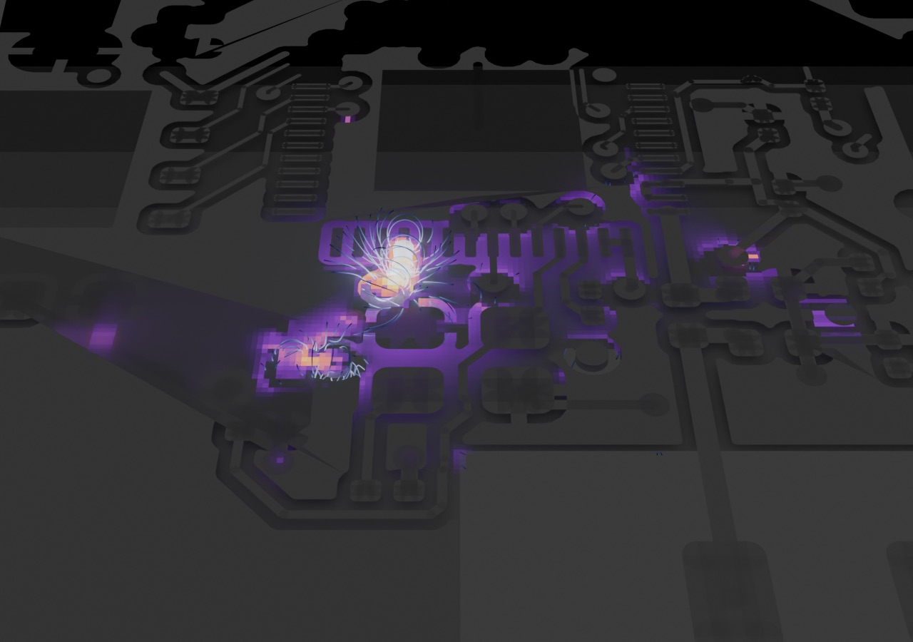

# fieldsolve: a PCB field solver (Rust, Metal)

`fieldsolve` is a 3-D finite-difference time-domain (FDTD) solver for PCB layouts. It reads the KiCad Gerber
output the router flow already produces (copper with X2 net/pad attributes, Excellon drills, the `.gbrjob`
stack-up), meshes a region of interest and computes port impedances, S-parameters, loop inductance and
field snapshots. It runs on the CPU (rayon) or on Apple GPUs (Metal); both give the same numbers.

Typical checks:

- **Decoupling loop inductance.** Put a port at an IC power pin, short (or load) the decoupling capacitor,
  and read the inductance from Z(f) at low frequency.
- **RF frontends.** Ports at the radio pin and at the u.FL/antenna feed give the S-parameters of the
  matching network and the line between them, including the board's parasitics.
- **Field pictures.** Field snapshots at chosen frequencies export to VTK (ParaView) and load into Blender.

## Choice of method and reference

| Solver | Method | Licence | Fit for us |
|---|---|---|---|
| [openEMS](https://github.com/thliebig/openEMS-Project) | EC-FDTD on a rectilinear non-uniform mesh | GPLv3 | **Reference.** It uses the same method, so it can be fed the exact same mesh. It is the established open PCB solver: [gerber2ems](https://github.com/antmicro/gerber2ems) (Antmicro, Apache-2.0) drives it from KiCad Gerbers and was validated against VNA measurements. |
| [FastHenry2](https://github.com/hpretl/FastHenry2) | PEEC, magneto-quasi-static | free | A good second opinion for loop inductance. It gives L and R only, with no resonances or radiation, and needs a filament model of the copper. |
| Palace (AWS), Elmer | FEM, frequency domain | Apache-2.0 / GPL | Accurate, but meshing PCB copper for FEM (gmsh) is a project of its own. |
| MEEP | FDTD | GPL | Aimed at photonics; it has no lumped ports or PCB input. |

FDTD covers both use cases with one engine. Low frequencies (inductance) and RF (S-parameters, antennas)
come out of the same broadband run. Its stencil is a perfect GPU workload, and a layered board maps
naturally onto a rectilinear mesh. fieldsolve is written from the textbook method (Yee, Taflove; CPML after
Roden and Gedney). openEMS is only run externally as a cross-check, so its GPL does not apply to our code.

## Model

- **Geometry.** Copper is a zero-thickness conductor on the mesh plane of its layer (perfect, or with a surface impedance: see conductor loss below), as in openEMS
  PCB models and gerber2ems. An in-plane E edge is metal when its midpoint lies in copper. Gerber
  primitives (flashes, macros, tracks as capsules, regions, LPC clears) are rasterised in file order. An
  aperture macro's exposure-off primitives cut holes in that aperture's own image only, so copper drawn
  earlier shows through them (as the Gerber specification requires).
  Plated holes are solid conductor columns: z edges at the mesh nodes inside the drill, or at the nearest
  node for holes thinner than a cell. Copper is only rasterised inside the fine-meshed copper window (ROI
  plus `air`). Outside it, whatever crosses the window's edge continues straight out to the grid boundary,
  so a cropped plane or track runs into the absorbing layer instead of ending inside the domain.
- **Net-aware raster.** Every metal edge remembers the Gerber net (X2 `.N`) of the copper that painted
  it. Wherever two nets' edges would share a mesh node (a gap of about a cell or less), the minority net's
  edges at that node are dropped. Wherever a via barrel's nodes touch another net's copper (an antipad too
  small for the mesh), that copper's edges are dropped. Before every run a connectivity check floods net
  labels through copper and barrels and warns about any remaining place where two nets meet
  (`mesh_shorts` in `result.json`). Copper added for elements (bridges, shorts) is exempt.
- **Stack-up.** Dielectric thicknesses, εr and tan δ come from the `.gbrjob`, with 4.5 / 0.02 when it gives
  none, or from the spec's `"dielectrics": [{"t": mm, "er": .., "tand": ..}, ...]` (top to bottom between
  the copper layers). The bottom copper is at z = 0 and copper thickness is ignored. Dielectric fills cells
  inside the board outline. Solder mask is optional (`solder_mask`).
- **Dielectric loss.** By default tan δ becomes a constant conductivity at `f_loss`, so the loss is right
  only near `f_loss`: the effective tan δ falls as 1/f above it, and resonances ring far too long (Q 4-8×
  too high at 4-8 GHz with `f_loss` at 1 GHz). `"loss": {"model": "wideband", "f_lo": 0.3e9, "f_hi": 10e9,
  "f_ref": 1e9}` instead fits a sum of Debye poles to a flat tan δ, which is how FR4 behaves
  (Djordjevic-Sarkar): one pole per decade from f_lo/3 to 3·f_hi, at most eight, with non-negative weights
  fitted by NNLS. εr is matched at `f_ref`. The fit is flat to about 1 % over the band (`disp.rs`). The poles
  run as auxiliary-current ADEs on the edges in dielectric, on the CPU and in the fused Metal kernels.
  `"copper": true` adds the plane-pair copper loss of each slab as an extra tan δ of about δ_s/h (skin depth
  over slab thickness, rising as √f). That is a stand-in for conductor loss between planes only; use
  `"conductor"` (below) instead.
- **Conductor loss.** `"conductor": {"sigma": 5.8e7, "roughness_um": 1.0}` (or `true` for these defaults)
  gives every copper sheet edge a surface impedance instead of a perfect conductor (`cond.rs`). For a
  conductor of thickness t with current on one face, Z_s = k/σ · coth(kt), k = (1 + j)/δ: 1/(σt) at DC and
  (1 + j)/(σδ) once the skin depth δ is well below t. Roughness multiplies it by the Hammerstad-Jensen
  factor 1 + (2/π) atan(1.4 (Δ/δ)²), which approaches 2 when the rms roughness Δ exceeds δ; standard
  electrodeposited foil on FR4 is about 1-2 µm, against δ = 1.3 µm at 2.4 GHz. Thickness per layer comes
  from the stack-up (`"thickness_um"` overrides it).
  - On a sheet edge, E = Z_s · J_s. J_s is the curl of H across the sheet times the dual edge length.
  - Z_s is fitted as a chain of parallel RL sections, two per decade from below the thickness transition to
    3 · f_hi. Each section's current is integrated exactly over a step, so the update is explicit and stable.
    `fieldsolve cond-fit` prints the fit; the loss (Re Z_s) is within 1-5 % over the band.
  - Current is assumed to flow on one face. That is right for a trace over a plane and for a plane under a
    trace. It overestimates an isolated strip carrying current on both faces by up to 2×.
  - Vias and barrels, port and element bars (the part bodies, whose loss is in the part model) and copper
    inside the absorber stay perfect conductors.
- **Mesh.** Uniform `cell` in x/y over the copper window (ROI plus `air`) and `cell_z` (at least `min_cells_layer` cells per
  dielectric layer) through the board, growing by at most 1.3× per cell outside, up to λ/20. Every
  copper interface and every port coordinate is a mesh line.
- **Boundaries.** CPML (κ = 1, cubic σ grading, α for low-frequency absorption), `pml` cells on each face.
  A cropped ROI leaves the board's planes cut at the PML, which acts like infinitely extended planes. That
  is right for local loop inductance; for whole-board plane resonances, use the full outline as the ROI.
- **Lumped elements.** Ports, resistors and parallel capacitors sit on a box of edges: k in series and m in
  parallel, R·m/k and C·k/m per edge. They are semi-implicit (folded into the update coefficients) and so
  unconditionally stable. A port is a resistive voltage source. V is the line integral of E from + to −,
  and I = (Vs − V)/R exactly as the update applies it. Port edges override copper they overlap. A `short`
  is a perfect conductor. A vertical port or short at a pad spans the pad's footprint (80 % of its
  bounding box) by default; `"size": "point"` gives a single mesh line, which does not converge with the
  mesh (it is a zero-radius wire).
- **Multi-port S-parameters.** With every port excited, S = B·A⁻¹ from the wave matrices of all runs, so
  the port terminations need not equal the 50 Ω reference. The impedance matrix is in `result.json`.
  With one excitation, `s_col_db` holds b_k/a_j with the other ports terminated in their own R.
- **Excitation and stopping.** The excitation is a Gaussian, openEMS's `SetGaussExcite(0, fmax)`. Two rules
  can stop a run; `"stop"` chooses:
  - `"ports"` (default): stop when the signal energy at every port, over a sliding window, has fallen
    `end_db` below the largest seen. This is what the S-parameters depend on. It ignores slow ringing of
    plane modes that the ports do not see.
  - `"energy"`: stop when the total field energy falls `end_db` (default −70 dB) below its peak.

  With a far-field box the run also waits for the Poynting flux through the box to settle, at every far-field
  frequency, to within `farfield.tol` (default 1 %). That check gates both rules: neither ends a run before
  the flux has settled, and only `max_steps` does. Stopping on the ports alone underestimated radiated
  power by 1.3-2.2 dB on 1BP. Every run logs the late-time energy decay: dB/ns and the Q it implies at
  fmax/3. A positive rate is flagged as numerical growth, not ringing.

## Usage

```sh
cargo build --release --bin fieldsolve
kicad-cli pcb export gerbers --check-zones -o gbr/ board.kicad_pcb
kicad-cli pcb export drill --format excellon --excellon-separate-th -o gbr/ board.kicad_pcb
target/release/fieldsolve run spec.json            # --backend auto|metal|cpu, --out DIR
target/release/fieldsolve svg gbr/ board.svg       # the imported layout, layers toggleable
target/release/fieldsolve selftest                 # analytic validation cases
target/release/fieldsolve farfield-check           # free-space dipoles against theory (far field)
target/release/fieldsolve loss-check               # lossy cavity Q: constant sigma vs wideband dielectric
target/release/fieldsolve debye-port-check         # two-port microstrip with the wideband dielectric: passivity
target/release/fieldsolve copper-check             # copper cavity Q against h/delta (conductor loss)
target/release/fieldsolve cond-fit [--rough-um 1]  # copper surface impedance: exact vs the fitted network
target/release/fieldsolve cosim cosim.json         # parts on the EM N-port (see below)
target/release/fieldsolve bench spec.json [steps]  # Metal kernel variants and threadgroup shapes on a real problem
target/release/fieldsolve raster spec.json F.Cu x0 y0 x1 y1   # ASCII view of the metal edges as meshed
target/release/fieldsolve prims board.GTL > prims.json        # a Gerber's primitives (shape, polarity, net)
```

`raster` shows what the mesh actually made of the copper in a small window: metal edges, element and port
edges, cleared gaps. Use it to check a port or a narrow gap before a long run. `prims` dumps a layer's
primitives as polygons, circles and capsules, for editing layouts in scripts (the 1BP transplant was built
this way).

A decoupling-loop spec for the AMOLED board's ESP32-S3 3V3 pin 46 and its capacitor C112. Coordinates are
in KiCad's frame (`"coords": "kicad"`); pads are `REF.PIN` from the Gerber X2 attributes:

```json
{
  "gerbers": "amoled_gbr", "out": "run_decap",
  "roi": [9.0, 30.0, 18.5, 37.0], "cell": 0.1, "air": 2.0, "air_z": 3.0,
  "fmax": 3e9, "fmin": 10e6, "nf": 300,
  "ports": [{"name": "U1_VDD", "at": "U1.46", "from": "F.Cu", "to": "In1.Cu", "r": 10}],
  "elements": [{"kind": "short", "pos": "C112.1", "neg": "C112.2", "layer": "F.Cu"}],
  "l_band": [50e6, 300e6],
  "fields": {"freqs": [100e6, 1e9]}
}
```

Ports and elements come in two forms:

- **Vertical.** `"at"` (pad or `[x, y]`) with `"from"`/`"to"` layers; the + terminal is on `from`.
  Optionally `"size": [w, h]` spreads the port over an area.
- **In-plane, between two pads.** `"pos"`/`"neg"` with `"layer"`. A copper bar as wide as the smaller pad
  joins the pads, and a one-cell gap at the midpoint holds the element: the body of a two-terminal part.
  For pads not on a common mesh line (a part rotated by, say, 45°, offset by more than 1.5 cells across the
  dominant axis) the bar is a one-cell staircase along the mesh from each pad centre instead, and the gap
  sits in the middle of the copper-free stretch between the pads, not at the midpoint (which can lie in a
  pad's own copper or a pour). `"straight": true` forces the old straight bar.
  The element's edges span 80 % of the bar's width, and the gap column is cleared of other copper (a pour
  between the pads would otherwise short the element). With edges on the full width, the outermost ones
  could have no metal at one end: they carried source and probe without being in the circuit, which read
  as a flat 2-14 % "loss" in the port.

`kind` is `port` (the default in `ports`), `short`, `R` (`"r"`) or `C` (`"c"`, in parallel). `"excite":
"all"` runs every port and writes the full Touchstone file; by default only the first port is excited.

The run prints the net under each port terminal (`port CHIP: + ANT (F.Cu) / - GND (F.Cu)`). It warns when
neither end of a vertical port is on a net whose name contains `GND`. Check the reference before a long
run. An inner layer is often a power plane, not ground. In the window, a power plane connects to nothing
unless its decoupling capacitors are modelled. A port referenced to that plane, or a feed running over
it, then sees the plane ringing as a patch between the ground layers. On 1BP, In1 is the `VCC2V4` plane.
A chip port from the ANT ball down to In1 showed sharp absorption notches at 2.32, 2.95 and 7.55 GHz.
The fix is to reference the port to a neighbouring GND ball, or a GND pad, on the same layer. Also add the
plane's decoupling capacitors in the window as `short` elements, so the plane is tied to ground the way
it is at RF.

With `"excite": "all"` the run checks each port's power balance, 1 − Σ|S_kj|², over the lowest tenth of
the band, where radiation and dielectric loss are negligible. It warns when that exceeds 2 %: a port whose
edges are not all in the circuit, or a port across something it should not be. The values are
`port_power_balance` in `result.json`.

Outputs in `out/`:

- `result.json`: per excited port, Z(f), |S11| in dB and the R + jωL fit over `l_band`.
- `sparams.sNp`.
- `scene.json`: exactly what was simulated, for the openEMS cross-check.
- `fields/`: see below, including the vector fields for `fieldsolve lines`.

### Co-simulation: parts on the EM N-port

For a frontend, run the board with the parts removed. Put a port across every part's pads, plus ports at the
chip pin and the connector (`"excite": "all"`). `fieldsolve cosim` then connects part models to that
N-port. A two-terminal part across its own port is a one-port load, so connecting it terminates that port:
with Γ = (Z − Z0)/(Z + Z0) on the terminated ports t and the kept ports e,
S'ₑₑ = Sₑₑ + Sₑₜ Γ (I − Sₜₜ Γ)⁻¹ Sₜₑ. That takes microseconds per frequency, so part values and part numbers
can be swapped without a new EM run.

```json
{ "em": "run/sparams.s6p", "out": "cosim", "keep": ["CHIP", "J1"],
  "ladder": [["shunt", "C21"], ["series", "L4"], ["shunt", "C18"], ["series", "L3"]],
  "variants": {
    "ideal parts":  {"C21": "C:1p", "L4": "L:4.7n", "C18": "C:1.2p", "L3": "L:2.2n"},
    "typical 0402": {"C21": "C:1p,esr=0.3,esl=0.35n", "L4": "L:4.7n,srf=6G,q=20@2.4G",
                     "C18": "C:1.2p,esr=0.3,esl=0.35n", "L3": "L:2.2n,srf=10G,q=20@2.4G"} },
  "zref": {"CHIP": [50, 0]},
  "report": [2.44e9, 4.88e9, 7.32e9] }
```

Part models:

| Model | Meaning |
|---|---|
| `C:<value>` | Capacitor. Optional `esr=` and `esl=` add series ESR and ESL. |
| `L:<value>` | Inductor. Optional `srf=` adds a parallel C. Optional `q=Q@f` adds a series R that scales as √f. |
| `R:<value>` | Resistor. |
| `open`, `short` | Open or short circuit. |
| `s2p:FILE` | Vendor two-port measured in series through a fixture (Murata): Z = 2Z0·S11/S21. |
| `s2p-shunt:FILE` | Vendor two-port measured as a shunt to ground on a through line (Yageo): Z = −Z0·S21/(2·S11). Check the file: a shunt part has \|S21 − S11\| = 1, a series part \|S11 + S21\| = 1. |
| `s1p:FILE` | Vendor one-port. |

Both two-port forms are ratios, so a symmetric matched fixture line left in the data cancels. Outside a
file's frequency range the nearest value is held.

Port names come from `result.json` next to the EM file.

Optional settings:
- **`ladder`:** the same parts are also cascaded as an ideal ladder (ABCD) with no layout, so the
  layout's own effect is the difference between the two.
- **`zref`:** renormalises the kept ports to complex reference impedances (power waves), e.g. a chip's
  optimum load. The report's S columns use these references; its impedances are always physical. A
  Touchstone v1 file declares one real reference, so the exported network is renormalised only when every
  `zref` is the same real value; otherwise it is written at the EM file's reference (`touchstone_z0` in
  `cosim.json` says which).
- **`target`:** a measured matching network, a two-port with port 1 on the chip side. Loaded with 50 Ω,
  it gives the impedance the chip is designed to see. Each case gets a column |Γ| = |(Zin − Zt)/(Zin + Zt*)|
  against it, which is only meaningful in band. Use the vendor's own measured reference network: it
  includes their layout, so their parasitics are already in the target. A hot S22 measured at the
  connector with the chip transmitting is not this target.
- **`plot_ideal`:** `false` leaves the ideal-ladder curves out of the plot and the table.
- **`deembed`:** `true` removes, from every part, the inductance of its port's bar across the pad gap.
  - Why: an in-plane port is a copper bar between the pads with a one-cell gap. The current crossing the
    pad gap through that bar has inductance in the EM model. A vendor part measured on its own fixture
    already contains its body's inductance across the same gap, so connecting it to the bar counts that
    inductance twice.
  - How much: the run measures the stretch of each bar that lies over no copper and writes its partial
    self-inductance to `result.json` (`port_bars`, Grover's flat-strip formula). Across an 0402 pad gap
    (about 0.5 mm) that is 0.1-0.2 nH. It shifts a 1 pF capacitor's self-resonance by 10-15 % and moves
    harmonic traps accordingly.
  - It is a first-order correction. The real body sits above the pads and its loop over the board's ground
    differs from the vendor fixture's. The faithful alternative is a 3-D part body with an intrinsic part
    model, which needs a calibration against the vendor's fixture for each part family.
- **`deembed_kept`:** `true` also removes the kept ports' bar inductance in series, which moves their
  reference planes to the pad edges (for comparison with measurements referenced there).

The S11 in the table and plot is referenced to 50 Ω at the chip side. A chip whose RF pin does not want
50 Ω looks mismatched there however well it is matched, so judge the match by the target column.

Outputs:
- `<variant>.s2p` for each variant;
- `cosim.svg`, a plot of |S11| and |S21|;
- `cosim.json`;
- a table of S11, S21 and Zin at the report frequencies.

### Far field: near-to-far-field transform

`"farfield": {"freqs": [2.44e9, 4.88e9], "step_deg": 5, "gap": 3}` in a run spec puts a closed box of
mesh planes `gap` cells inside the absorbing boundary on every side. Every excitation records the
tangential E and H on its faces as running DFTs at those frequencies. The engines' gathered DFT does this
on Metal and on the CPU, touching only the face samples. Afterwards each face cell carries the equivalent
currents J = n × H and M = −n × E. The radiation integrals give r·E_θ and r·E_φ on a θ/φ grid
(Balanis, *Advanced Engineering Electromagnetics* 6.8; e^{jωt}, the sign of the field DFT).

**The box must be in free space, with everything that radiates inside it.** The run warns when tangential E
edges on its faces are not free space. A window of a board (the default `roi` domain) is cut at the domain
edge, so its far field is meaningless. For far-field runs use:

- **`"extent": "board"`:** the domain is the whole board outline plus `air` (and `air_z` above and
  below). The `roi` stays the fine-meshed region; cells grade up to `max_cell` outside it. Copper is
  rasterised everywhere: on coarse cells small gaps merge, which is fine for planes and wrong for fine
  detail away from the `roi`. The absorbing layer gets its own width beyond the air margin.
- **`"decouple": [{"net": "VCC2V4", "from": "In1.Cu", "to": "In2.Cu"}]`:** every two-pad part outside the
  `roi` with one pad on `net` and the other on GND becomes a vertical short at that pad. This ties a power
  plane to ground the way its capacitors do at RF. Without it, a power plane floats and rings (see the
  power-plane note under ports). `"esr": 0.03` makes each a resistor instead of a short, which damps the
  plane modes the way real capacitors do. Inside the `roi`, list the capacitors as elements yourself.

Use at least λ/8 of air at the lowest far-field frequency, or reactive near fields reach the absorber and
read as radiated power. The transform itself is exact for any closed box in free space.

Radiation efficiency divides by the power the port accepts, 1 − |S11|². When that is tiny, for example an
electrically short antenna on a 50 Ω port at 4 × 10⁻⁶, the f32 port probes cannot resolve it: the short
dipole read 110 % at 1 GHz although its radiated power matched the box flux to 0.2 %.

**Patterns per port.** With `"excite": "all"` the patterns are combined with the inverse of the wave
matrix, F = F_run·A⁻¹, exactly as S = B·A⁻¹. Each port then has a pattern per 1 W incident with the
other ports matched to 50 Ω. Those patterns add linearly with any port waves.

Outputs:
- **`farfield.json`:** θ/φ grid, per-port patterns (r·E_θ, r·E_φ, peak, per 1 W incident) and a summary.
- **Summary per port and frequency:** radiated power, power accepted at the port, power out of the other
  ports, loss, directivity, gain, realised gain, radiation efficiency, direction of the maximum, and a
  check: the far field integrated over the sphere against the Poynting flux through the box.
- **`farfield_<port>_<f>GHz.svg`:** polar cuts of the realised gain (xz, yz, xy planes).

**Radiated against conducted power with parts.** `"farfield": true` in a `fieldsolve cosim` config reads
`farfield.json` next to the EM file. For each variant it drives the first kept port with 1 W incident,
lets the parts set the waves on their ports (a_t = Γ(I − S_tt Γ)⁻¹ S_te a_e), and adds the per-port
patterns with those waves. It reports the power reaching the other kept port (the connector), the
radiated power, their difference, and the maximum EIRP relative to the conducted power. For harmonics
this split does not depend on how much the chip generates: a conducted harmonic level at the connector
plus "radiated − conducted" gives the radiated level.

## Validation

`fieldsolve selftest` and `cargo test --release --bin fieldsolve` run closed-form cases. The numbers below
are at the default mesh; Metal and CPU agree to about 1e-6 relative.

| Case | Quantity | fieldsolve | Reference | Error |
|---|---|---|---|---|
| Empty PEC box 30×20×10 mm, graded mesh | TM110 / TM210 / TM120 | 9.010 / 12.496 / 15.790 GHz | analytic | +0.03 / +0.04 / −0.07 % |
| Microstrip w 3, h 1.6 mm, εr 4.3 (probes, 0.2–2 GHz) | Z0, εeff | 49.94 Ω, 3.282 | Hammerstad–Jensen 51.14 Ω, 3.258 | −2.4 %, +0.7 % |
| same, 2× mesh | Z0, εeff | 50.68 Ω, 3.277 | | −0.9 %, +0.6 % |
| Plane pair 40×30 mm, h 0.5 mm, εr 4.3 | f10 / f01 / f11 | 1.770 / 2.350 / 2.975 GHz | cavity model with open-end extension | −0.9 / −1.0 / +0.2 % |
| Patch 10×10 mm over ground, h 0.2 mm | C | 20.86 pF | wide-microstrip C with fringing | +4.1 % |
| Half-wave dipole 48 mm, 1 mm cells, free space (`farfield-check`) | D at 2.6 / 2.8 / 3.0 / 3.2 GHz | 2.06 / 2.11 / 2.17 / 2.24 dBi | sinusoidal-current theory 2.02 / 2.07 / 2.12 / 2.17 dBi | +0.04 to +0.07 dB |
| same | P_rad (far field) / P accepted at the port | 99.9–100.0 % | lossless: 100 % | ≤ 0.1 % |
| same | Poynting flux through the box / far-field P_rad | 0.999–1.000 | 1 | ≤ 0.1 % |
| Short dipole 10 mm (λ/30, λ/20) | D at 1.0 / 1.5 GHz | 1.76 / 1.77 dBi | 1.76 dBi | ≤ 0.01 dB |
| Hertzian dipole, exact fields on a box (unit test) | P_rad, Poynting flux, D | within 3 % | analytic | |
| Cavity filled with tan δ 0.02 (`loss-check`), constant σ at 1 GHz | Q at 4.5 / 6.2 / 8.4 GHz | 218 / 310 / 408 | 1/tan δ = 50 | 4-8× |
| same, wideband (Debye) | Q at 4.55 / 6.32 / 8.49 GHz | 47.5 / 47.9 / 44.5 | 50 (port loading alone: Q ≥ 894) | −5 to −11 % |
| Copper cavity 30×20 mm, plates 0.5 mm apart, smooth copper (`copper-check`) | Q at 4.50 / 6.24 / 8.37 GHz | 528 / 624 / 717 | h/δ = 508 / 598 / 692 | +3.6 to +4.4 % |
| same, 1 µm rms roughness | Q | 337 / 369 / 406 | h/δ/K = 315 / 351 / 391 | +3.9 to +7.2 % |
| Matched 30 mm microstrip, tan δ 0.015, wideband (`debye-port-check`) | 1 − \|S11\|² − \|S21\|² at 0.1 / 1.1 / 3.1 / 5.1 GHz | 0.3 / 2.1 / 5.8 / 9.7 % | passive, rising ∝ f | CPU and Metal agree to 0.001 |

Lessons from building these, which also apply to board runs:

- **Copper edges.** A zero-thickness copper edge sits best 1/3 of a cell inside the outermost metal mesh
  line (openEMS's "thirds rule"). With the edge exactly on a mesh line, the strip acts about half a cell
  wider and a microstrip's εeff came out 6 % high at 4 cells per substrate. The patch case keeps its edges
  on mesh lines and shows that bias. Board meshes are uniform, so edges fall at random positions; expect a
  few percent from this and check convergence with a finer `cell` (below).
- **Port parasitics.** A port's own vertical current path adds inductance. The microstrip case therefore
  uses voltage probes and current loops far from both ends (`add_vprobe`, `add_iprobe`). Probes within
  ~10 mm of a discontinuity picked up evanescent box modes and biased εeff by 2–6 %.
- **Stopping.** End on field energy, not port voltage: −50 dB of energy is only −25 dB of field, which
  truncated the ring-down.
- **Dispersion and sources.** With Debye poles, the source's share of each step's E change must reach the
  pole currents too. Injecting the source after the current update left the port edges' polarisation
  short of it, and the two-port came out non-passive (up to 15 % gain at 0.1 GHz).

### Port checks

`fieldsolve ports` runs a single series loop: a 3 mm trace over a plane, a port at one pad and a short at
the other, then the same with the ends swapped, for point and pad-footprint ports at three meshes.

| port | 0.1 mm | 0.05 mm | 0.025 mm | swapped ends |
|---|---|---|---|---|
| point (single node) | 1.305 nH | 1.264 nH | 1.284 nH | identical |
| pad footprint | 1.112 nH | 1.043 nH | 1.029 nH | identical |

Pad-footprint ports converge (steps of 6.6 % then 1.3 %); point ports do not.

openEMS agrees once it is given the same discrete structure:

| pad port | fieldsolve | openEMS, our raster | openEMS, its own rasterisation of the polygons |
|---|---|---|---|
| 0.1 mm | 1.112 nH | 1.122 nH (−0.9 %) | 0.896 nH |
| 0.05 mm | 1.043 nH | 1.051 nH (−0.7 %) | 0.940 nH |

The earlier 20 % gap was the two codes rasterising zero-thickness copper differently (a first-order mesh
effect), not the solvers.

### Board case: AMOLED ESP32-S3 3V3 decoupling (U1.46 → C112 → In1 GND)

| set-up (0.1 mm) | L |
|---|---|
| port at U1.46 (pad footprint, F.Cu → In1), C112 shorted | 1.557 nH |
| port across C112's pads, U1.46 shorted to In1 | 1.507 nH |
| from one 2-port run: 1/Y₁₁ and 1/Y₂₂ at 60 MHz | 1.540 / 1.540 nH |
| port at U1.46, C112 shorted, 0.05 mm (3.9 M cells, 400 k steps, 11 min on Metal) | 1.489 nH |

**Correction.** Earlier versions of this page reported 0.99 nH, and a −4.6 % difference from openEMS, for
this loop. That geometry was wrong: copper outside the ROI was rasterised on graded millimetre cells, and
sub-cell clearances inside it joined VCC3V3 to GND in dozens of places. The connectivity check now reports
any such short, and the net-aware raster prevents it. The openEMS comparison of that scene ran on the same
shorted polygons and does not count as validation. A like-for-like openEMS check needs our resolved
raster exported to openEMS; until then, see the port checks above.

The network around this loop matters: VCC3V3 also feeds U1's other pins and the In4 plane. So "port at
U1.46 with C112 shorted" and "port at C112 with U1.46 shorted" are different quantities (1/Y₁₁ vs
1/Y₂₂), and only for a pure series loop are they equal.

### Cross-check with openEMS

```sh
~/opt/openEMS/venv/bin/python tools/openems_scene.py RUN_DIR
```

This rebuilds `RUN_DIR/scene.json` in openEMS with fieldsolve's mesh lines (no smoothing):

- the resolved raster: every perfect-conductor edge fieldsolve used (copper after the net-aware conflict
  resolution, barrels, shorted elements) as wires along mesh lines, which openEMS maps to exactly those
  edges, and the dielectric as boxes of whole cells. `--polygons` gives openEMS the copper polygons,
  outline and barrels instead, to rasterise its own way;
- tan δ as conductivity at the same `f_loss` (the wideband and copper-loss models are not replayed: run
  fieldsolve without them for a like-for-like comparison);
- `AddLumpedPort` / `AddLumpedElement` on the same boxes;
- the same Gaussian, PML thickness and end criterion.

`--ports all` (or a list) runs one excitation per port, keeps each column in `RUN_DIR/openems/col_N.json`
so a long run can be resumed, and writes `sparams.sNp` once all exist. It prints both impedances of the
first excitation and the inductance fit over the same band.

**Board case: Nordic's nRF52840 reference, configuration 1** (6.6 M cells, the whole board, 5 ports, εr
4.2/4.8, 0.05 mm mesh on the RF path). All five excitations, 0.1-8 GHz:

| | 0.1-3 GHz | 3-6 GHz | 6-8 GHz |
|---|---|---|---|
| max \|S_fieldsolve − S_openEMS\|, CHIP column | 0.008 | 0.025 | 0.050 |
| max \|S_fieldsolve − S_openEMS\|, full 5×5 matrix | 0.010 | 0.049 | 0.103 |

At 2.44 GHz every entry agrees within 0.11 dB and 0.8°; along the network from CHIP the phase difference
grows to 1.5° at 7 GHz. A 10 % frequency-scale error would be tens of degrees there. The largest differences sit
at a weak board resonance near 7.5 GHz: openEMS ran into the 150 k step limit with its field energy at
−37 dB (its end criterion is total energy), while fieldsolve stopped on the port signals at 119 k steps.
openEMS's own matrix is reciprocal to 0.008.

With Nordic's parts on both matrices (`fieldsolve cosim`, v1.0 values, bars de-embedded):

| | S11 / S21 at 2.436 GHz | S21 at 4.87 / 7.33 GHz | best frequency scale of \|S21\|, 1-6 GHz |
|---|---|---|---|
| fieldsolve | −3.27 / −3.45 dB | −61.7 / −23.9 dB | |
| openEMS | −3.34 / −3.33 dB | −54.1 / −26.4 dB | 0.998 (v1.1 values: 0.995) |

In band the two agree within 0.12 dB, and their low-pass edges lie within 20 MHz (0.6 %). The H2 null
depth and the H3 level differ by several dB, as expected for a deep null and for the truncated resonance.

openEMS took 37-44 min per excitation on the M3 Max CPU (380 Mcell/s); fieldsolve 4 min on Metal. openEMS was built from
`openEMS-Project` with `update_openEMS.sh ~/opt/openEMS --python --disable-GUI`. The Homebrew formula is no
longer maintained.

## Fields and Blender

`fields/` holds, per snapshot frequency:

- `fields_<f>.vtr`: ParaView; |E|, |H| and the real-part vectors on the mesh nodes.
- raw `E_abs_<f>.f32` / `H_abs_<f>.f32` volumes.
- `J_<layer>_<f>.f32`: |n × (H⁺ − H⁻)|, the surface current density on each copper layer.
- `copper_<layer>.obj` and `meta.json`.

```sh
/Applications/Blender.app/Contents/MacOS/Blender --python tools/blender_fields.py -- RUN_DIR/fields \
    --freq 0.1000GHz [--field E|H] [--layers F.Cu,In1.Cu] [--no-copper] [--no-volume] [--top] \
    [--save scene.blend] [--render out.png]
```

The script builds the copper layers, one emissive plane per layer showing log |J| over 40 dB, and the field
magnitude as an OpenVDB volume (resampled to the finest cell, log over 50 dB). It uses only Blender's own
numpy and openvdb. Scene units are millimetres in Gerber orientation, with z up.

### Far-field patterns in Blender

```sh
Blender -b --python tools/blender_farfield.py -- cosim/farfield_<variant>_<f>GHz.json --board board_top.png \
    --outline X0 Y0 X1 Y1 --thickness 0.8 --centre X Y Z [--top DB --range 20] [--view rf] \
    [--render out.png] [--save out.blend]
python3 tools/render_farfield_panels.py PANELS.json OUT_PREFIX
```

`blender_farfield.py` takes a pattern written by `fieldsolve cosim` (`"farfield": true`). It draws the
board as a slab with a picture of its top copper, and the pattern as a surface around the radiating point.
Radius and colour both encode EIRP in dB over `--range` below `--top`, and a wireframe marks the scale.
Textures are packed into the saved `.blend`. `render_farfield_panels.py` renders several boards side by side,
one row per frequency, with a shared `--top` per row so the panels compare directly. It adds captions
(radiated and conducted power, peak EIRP) and a colour bar. `PANELS.json` lists each panel's cosim
directory, label, board picture, outline, thickness and centre. Set `FIELDSOLVE_FONT` to a font file for
the captions.

### Time-domain current frames and TDR

A spec's `"frames": {"layers": ["F.Cu", "In1.Cu"], "every_ps": 2, "until_ps": 500}` records the surface
current on those layers during the first excitation. The output is `frames/J_<layer>_<NNNN>.f32` plus
`frames.json`. `post::tdr` turns S11 on a uniform grid from DC into a TDR impedance curve, with a Gaussian
edge of 0.88 / f_top (44 ps for 20 GHz). The step integrates from before t = 0, because the window spreads
a reflection at the port itself symmetrically in time; starting at t = 0 had read an open as about half a
reflection.

`fieldsolve gap --out DIR` is the demonstration case: a fast edge on a 50 Ω microstrip (0.2 mm FR4,
30 mm long, matched at both ends) whose ground plane has a 1 × 10 mm slot across the trace's path. It is
run with and without the slot, and writes `tdr.svg`/`tdr.json` and the frames of both runs.

- **Solid plane:** the TDR is flat at 48.9-49.0 Ω.
- **With the slot:** a 110 Ω inductive bump at the slot. The return current, which runs under the trace,
  has to detour around the slot's ends; you can watch it crowd along the slot edges.

```sh
Blender -b --python tools/blender_frames.py -- DIR/slot --every 2 --explode 4 --render slot.mp4
ffmpeg -framerate 20 -i DIR/slot/frames/png/TOP_%04d.png -framerate 20 -i DIR/slot/frames/png/GND_%04d.png \
       -filter_complex vstack -pix_fmt yuv420p slot_2d.mp4
```

`blender_frames.py` writes colour-mapped PNGs per layer with a fixed scale over the run; upper layers fade
out where the current is weak. It then stacks the layers `--explode` mm apart, outlines copper and slots,
and renders an MP4 (Eevee, then ffmpeg).



### Field lines

```sh
target/release/fieldsolve lines RUN_DIR/fields --freq 0.1000GHz --field H --seeds 300 [--phases 12] \
    [--floor-db -40] [--max-len 60] [--crowd 3]
```

This traces streamlines of the instantaneous field Re[F·e^{jφ}] from the snapshot's complex node vectors
(`E_vec_<f>.f32` / `H_vec_<f>.f32`):

- RK4 on trilinear interpolation over the non-uniform node grid, with a step of half the local cell;
- seeds drawn in proportion to |F|, outside the PML;
- an occupancy grid keeps the line density even;
- closed loops (H around a trace) are detected.

`--phases N` traces N phases over one period. The output is `fields/lines_<F>_<f>.json`.

```sh
Blender --python tools/blender_fields.py -- RUN_DIR/fields --freq 0.1000GHz --lines lines_H_0.1000GHz.json \
    --lines-mode volume|tubes|both [--line-radius MM] [--fog-cut 0.5] [--render out.png]
```

The lines become an edge mesh with a log-magnitude attribute `mag`. A Geometry Nodes modifier turns them
into an emissive fog volume (points → volume, density and glow from the grid, thicker where the field is
stronger, the weakest part dropped below `--fog-cut`) and/or emissive tubes coloured by `mag`. With several
phases there is one object per phase, keyed to show on successive frames: the field animated over a
period. The camera frames the lines, unless you pass `--frame-all`.

Renders use Cycles on the Metal GPU. For interactive viewing, Eevee's volume range is set to the scene size:
its default 0.1–100 units turns millimetre fog into blocks.



## Code map

The code is in `src/bin/fieldsolve/`.

| File | Role |
|---|---|
| `gerber.rs` | RS-274X/X2 parser (macros, regions, arcs, polarity, step-repeat), Excellon (slots), `.gbrjob` stack-up, outline chaining, SVG view |
| `geom.rs` | shapes and inside tests |
| `mesh.rs` | graded 1-D line generation with fixed lines |
| `model.rs` | layout → per-edge coefficients, metal, barrels, lumped elements, CPML tables, probes |
| `fdtd.rs` | CPU reference stepping |
| `metal_fdtd.rs` + `shaders/fdtd.metal` | GPU stepping |
| `post.rs` | DFT, Z, power-wave S, R/L fit, Touchstone |
| `sim.rs` | spec → setup → runs → outputs; scene export |
| `export.rs` | VTK, raw volumes, complex vector fields, surface currents, copper OBJ |
| `lines.rs` | field-line tracing |
| `connect.rs` | mesh connectivity check (shorts between nets) |
| `cosim.rs` | Touchstone reader, part models, port termination, ideal ladder, renormalisation, radiated vs conducted |
| `nf2ff.rs` | near-to-far-field transform: box plan, face currents, patterns, power, polar plots |
| `disp.rs` | wideband dielectric: Debye pole fit to a flat tan δ, plane copper loss, update constants |
| `cond.rs` | conductor loss: copper surface impedance (skin effect, thickness, roughness), Foster fit, sheet edges |
| `tools/blender_frames.py` | time-domain current animation |
| `tools/blender_farfield.py`, `tools/render_farfield_panels.py` | far-field patterns over the board, panel comparisons |
| `cases.rs` | analytic validation cases |
| `tools/openems_scene.py` | openEMS replay of a scene |
| `tools/blender_fields.py` | Blender import |

## Next steps

The plan for radio frontends (EXT balun, nRF54 filters, u.FL) and antennas (free space, enclosure, pipe) is in
[fieldsolve-rf-roadmap.md](fieldsolve-rf-roadmap.md). Engine items:

- **Vertical ports through planes.** A vertical port or short whose column crosses an intermediate copper
  layer shares a node with it. Warn about this, or route the column only to the nearest reference layer.
- **Capacitor models.** Series R-L-C elements, so a real capacitor (ESR, ESL, C) can replace the short.
  That gives the PDN impedance curve |Z(f)| directly instead of only the loop L.
- **Conductor loss on vias and in the absorber.** Barrels and element bars stay perfect conductors, and so
  does copper inside the CPML. A two-face current model for isolated strips is also open.
- **Part bodies.** 3-D part bodies with intrinsic part models, calibrated against the vendors' fixtures,
  instead of the bar inductance correction.
- **Antennas.** The near-to-far-field transform is in place and validated on dipoles. Next: chip and trace
  antennas on a board, and an enclosure.
- **Ports and meshing.** Ports from net names (all VDD pins of a part to its GND pins); the thirds rule
  applied in the rasteriser (shrink copper by 1/3 cell at edges) instead of relying on random edge
  positions. (Against Nordic's measured network, modelled on the nRF52840 DK layout with the 2018 DK's thin-film
  inductor, the model's in-band S21 is about 1 dB low and its roll-off 5-9 % low. openEMS on the same
  raster agrees with fieldsolve, the mesh is converged in band and the stack-up barely matters, so the
  cause is not the solver or the cell size: see [1bp-rf-findings.md](1bp-rf-findings.md).)
- **Performance.** The CPML corrections are fused into the main Metal kernels, and materials are a 16-bit
  index into a coefficient table: 1769 → about 2100 Mcell/s on 5.8 M cells (M3 Max, `fieldsolve bench`).
  `FIELDSOLVE_FUSED=0` selects the separate kernels; the wideband dielectric needs the fused ones.
  Half-precision field storage is still open; most time on large runs is memory traffic.
- **Router input.** Read gridroute/topor `layout.json` directly, so a routed candidate can be checked
  without a KiCad round trip.
