# MTH R7A PCB antenna: findings from fieldsolve (Nov 2026)

MTH R7A (`p-hw/Revision_7/MTH`, KiCad conversion `p-hw/easyeda2kicad/7A/MTH`) is a 19.5 × 60 mm, 2-layer,
0.8 mm board. Its antenna, ANT1, is a meandered PIFA ("WCH_24G_PIFA_10mm_mod") across the top 6 mm, with
ground cleared on both layers below it. The antenna was left deliberately long, so it can be trimmed once
it is in the enclosure.

RF path, as populated:

- nRF52840 (U12, aQFN73, rotated 45°), ANT ball H23;
- C59 1.0 pF shunt, L4 4.7 nH series, C60 1.2 pF shunt, L5 2.2 nH series (Nordic's configuration 7
  values, the same as 1BP);
- R70 0 Ω, then the PIFA feed.
- **C20** is a shunt pad at the feed, not fitted.
- **The IPEX connector U24** hangs off R69, which isn't fitted, so it isn't in the RF path.
- **Parts:** the capacitors are Fenghua 0402CG and the inductors Murata LQG15HS.

> **Revised (7 Nov 2026).** The first version of this note came from an EM run that meshed the antenna's
> open end coarsely. Its fine region started at x 145 mm, but the radiator arm runs from x 141.9 to 144.35
> mm, so the open end fell in graded cells of 0.35-0.5 mm. That made the antenna look electrically longer:
> it seemed to resonate below 2.40 GHz, and the recommended fix (L5 → 0 Ω, C20 = 0.5 pF) was fitted to the
> wrong antenna.
>
> Everything below comes from a new 7-port run with the open end resolved and the sub-cell edge
> corrections on. A 0.035 mm run checks the mesh. The old figures are listed under
> [Superseded results](#superseded-results-coarse-open-end). **Don't fit the old fix: on the resolved
> antenna it is worse than as built.**

## Summary

- **The antenna is good.** In free space it resonates near 2.45 GHz, mid-band, at about 50 Ω (49.6 − j2.4 Ω
  at 2.44 GHz). It radiates 83-91 % of the power it accepts; the figure depends on the mesh (see
  [Caveats](#caveats)). The enclosure, solder mask and battery will all pull the resonance down, so the
  room left for trimming is smaller than first thought.
- **The ladder transforms it too high.** The configuration-7 values were designed for a 50 Ω connector.
  On this antenna the chip sees 57 − j51 / 59 − j39 / 73 − j37 Ω at 2.40 / 2.44 / 2.48 GHz, against its
  35 − j35 Ω design load. The worst in-band case is −2.55 dB, at 2.48 GHz, or −2.9 dB with a real 0 Ω
  jumper for R70.
- **The cheapest fix: C59 → 0.6 pF and C60 → 0.5 pF**, with L4, L5 and R70 unchanged and C20 still not
  fitted. That is two value changes and no new footprint.
  - The chip then sees 63 − j39 / 43 − j43 / 30 − j38 Ω.
  - The score is flat across the band: −1.39 / −1.28 / −1.21 dB, or −1.30 dB worst with a real 0 Ω
    jumper. The worst case improves by 1.2-1.6 dB.
  - On the finer-mesh antenna it is still the best two-part change.
  - Cost: H2 is unchanged (−25.4 dB against −25.8) and H3 is 1.7 dB higher (−18.3 dB against −20.0).
- **C59 0.7 pF with C60 0.6 pF is equivalent** with an ideal 0 Ω jumper (−1.37 dB worst). It drops to
  −1.53 dB with a real one.
- **Bigger retunes gain little.** The best search result that keeps the harmonics changes five parts for
  the same −1.37 dB worst case. The best overall reaches −1.26 dB, but its H2 is 11 dB worse.
- **H2 suppression is weak.** The radiated H2 is −25.8 dB per watt into the chip pin, against −29.7 dB for
  1BP as built and −49.3 dB for Nordic's reference layout. C59's ground pad is flooded into the top pour,
  the same deviation found on 1BP ([1bp-rf-findings.md](1bp-rf-findings.md)). The same fix should apply:
  an isolated return to VSS_PA. That fix hasn't been simulated here.
- **The bottom-layer 3.3 V copper costs about 4 points of efficiency in band.** VCC3V3 is poured on B.Cu as
  a U-shaped strip along three board edges, with its open ends next to the RF corner, and drops to B.Cu in
  short jogs beside C30 and C16. With all of it turned into ground, the antenna radiates 86.9 / 85.6 /
  84.2 % at 2.40 / 2.45 / 2.50 GHz instead of 83.5 / 81.4 / 81.3 %, and its impedance doesn't move.
  Passing 90 % also needs a lower-loss laminate or less FR4 under the antenna (see
  [Efficiency](#efficiency-losses-and-the-33-v-ring)).
- **Retune again after trimming.** The trimmed antenna in the enclosure will present a different feed
  impedance. Re-run the EM model on the trimmed copper, plus the enclosure if there is data, and repeat
  the retune. The retune takes about a minute and the 7-port EM run about 30 minutes.

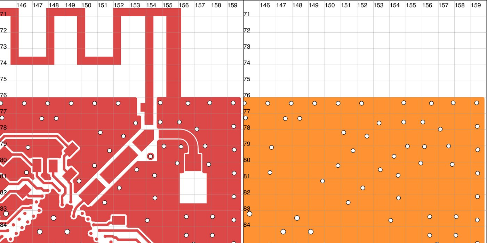

## Model

- **The whole board** in free space, from the KiCad conversion's X2 Gerbers, with far field from a
  Huygens box in 15 mm of air.
  - 0.05 mm cells over the ROI [141.5, 70, 159.6, 87.5], which takes in the whole antenna, graded
    outside.
  - Sub-cell edge corrections are on (`"edges": true`), as is the static mesh refinement
    (`"mesh": {"no_slivers": true, "z_grade": 3.0}`).
  - 12.1 M cells; all seven excitations took 30 minutes on an M3 Max.
- **Stack-up:** one 0.73 mm FR4 core (εr 4.5, tan δ 0.015, wideband Debye fit) between 35 µm copper.
  The order notes give the finished thickness but not the laminate, so εr is assumed.
- **Copper loss is not properly modelled here.** These runs used `"loss": {"copper": true}`, a plane-pair
  stand-in that adds about δ_s/h to the core's tan δ and leaves the copper itself lossless. The
  surface-impedance model (`"conductor": true`, now part of `"preset": "antenna"`) wasn't used. A check
  with real copper gives 4-5 points lower efficiency (see Caveats), so the efficiencies and scores below
  are about 0.2-0.3 dB optimistic. The ladder ranking doesn't change. See
  [fieldsolve-settings.md](fieldsolve-settings.md).
- **Ports:** the chip pin (H23 to the F23 ground ball), each ladder part, R70 and the C20 pads. The
  decoupling capacitors near the chip are modelled as shorts: twelve in the earlier runs, nine (the
  fitted ones) since the BOM check. `fieldsolve cosim` places measured parts
  on the ports: Murata GRM1555 for the Fenghua capacitors, which have no published data, and the exact
  LQG15HS inductors.
- **Mesh check:** a one-port run at C20 at 0.035 mm (24.3 M cells), and the same at 0.05 mm.
- **Not modelled:** solder mask, enclosure, battery. All three pull the resonance down.
- **A solver bug was found and fixed along the way.** Every part here is rotated 45°, the chip included.
  Ports between pads that don't share a mesh line used to get a straight bridge that missed the far pad
  and shorted the port: the first run showed the chip seeing 0.05 + j26 Ω. Such ports now get a
  staircase bridge, with the gap in the copper-free stretch between the pads (commit 2918126, tests in
  `review_tests.rs`). No earlier board had rotated parts.

## The antenna alone

Seen at the feed (the C20 pads), with R70 and the chip open:

| | 2.40 GHz | 2.44 GHz | 2.48 GHz |
|---|---|---|---|
| impedance, 0.05 mm (7-port) | 67.9 − j14.7 Ω | 49.6 − j2.4 Ω | 37.8 + j9.5 Ω |
| S11 (50 Ω) | −14.2 dB | −32 dB | −15.1 dB |
| radiation efficiency | 83 % | 82 % | 83 % |
| impedance, 0.035 mm (one-port) | 74.7 − j11.2 Ω | 55.5 − j2.5 Ω | 42.1 + j7.5 Ω |
| S11 (50 Ω) | −13.3 dB | −24.8 dB | −18.6 dB |
| radiation efficiency | 91 % | 89 % | 87 % |

The one-port run at 0.05 mm reads 68.8 − j12.4 / 50.3 − j1.3 / 38.1 + j9.9 Ω, within about 2 Ω of the
7-port. So the differences between the two meshes are a mesh effect, not a difference between the
setups. The resonance (X = 0) sits near 2.45 GHz on both meshes. The finer mesh raises the resistance by
about 6 Ω and the efficiency by up to 8 points (see [Caveats](#caveats)).

## As built, seen from the chip pin

The score is the power the chip delivers into its design load (1 − |Γ|² against Nordic's measured network,
35 − j35 Ω at 2.44 GHz), times the share of the power entering the pin that is radiated (ladder plus
antenna loss).

| | 2.40 GHz | 2.44 GHz | 2.48 GHz |
|---|---|---|---|
| chip sees | 57 − j51 Ω | 59 − j39 Ω | 73 − j37 Ω |
| \|Γ\| against the design load | 0.26 | 0.25 | 0.38 |
| radiated / accepted | 70 % (−1.6 dB) | 68 % (−1.7 dB) | 65 % (−1.9 dB) |
| score | −1.9 dB | −2.0 dB | −2.6 dB |
| score, R70 as a real 0 Ω jumper (0.4 nH) | −1.9 dB | −2.1 dB | −2.9 dB |

## Radiation pattern

At 2.44 GHz the peak realized gain is +1.5 dBi, for a 50 Ω source at the chip pin. The 60 mm board is
about half a wavelength long, so its ground currents radiate like a dipole along the board's long axis:

- a near-omnidirectional ring of about −1 dBi (E_φ) in the plane across the board (x-z);
- a figure-of-eight of E_θ in the y-z plane, with nulls off the board's ends;
- the antenna arm's own x-directed current fills those nulls only partly.

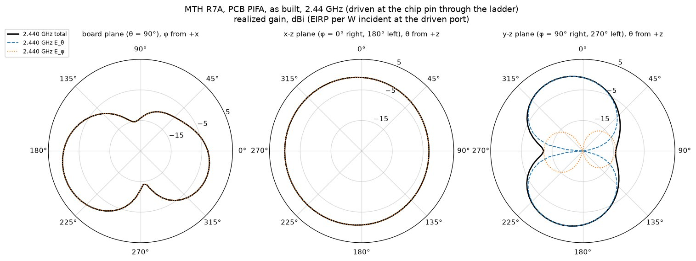

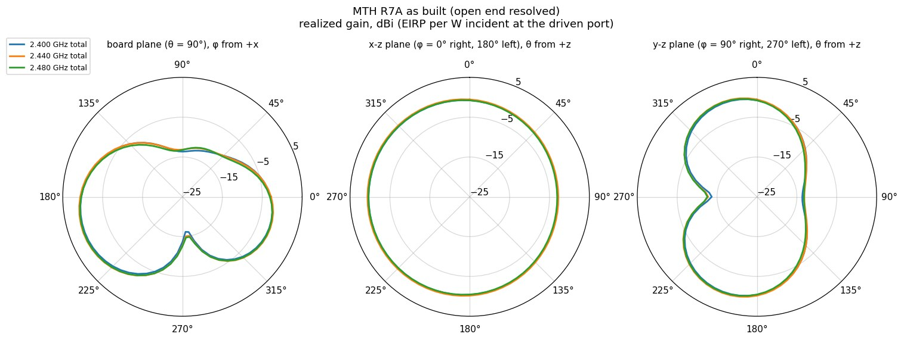

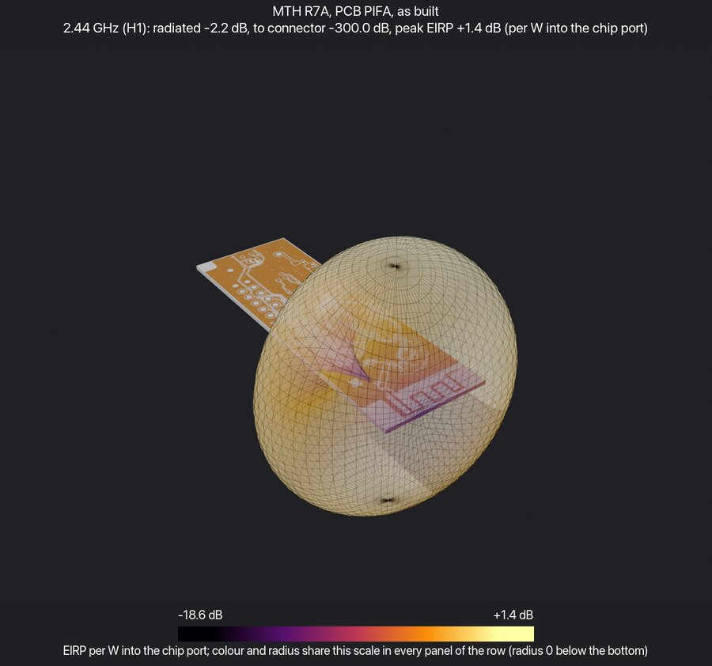

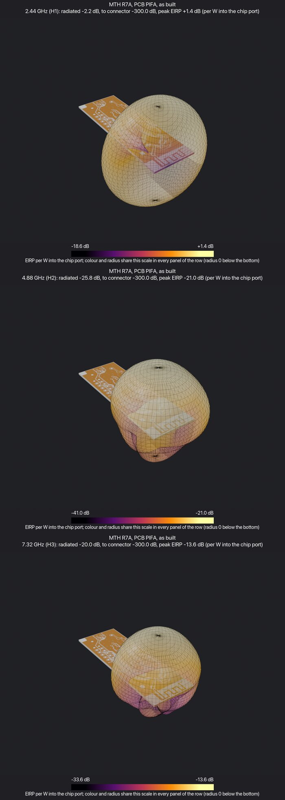

Radiated harmonics, per watt into the chip pin (50 Ω), as built: **H2 −25.8 dB, H3 −20.0 dB.**

## Retune

Every ladder position was varied over real part values:

- capacitors: Murata GRM1555, 0.2-8.2 pF, or open;
- inductors: Murata LQG15HS, 1.0-8.2 nH, or short;
- R70: a short, an inductor up to 4.7 nH, or a series capacitor;
- C20: open or up to 2 pF.

Each candidate was scored with `fieldsolve cosim` (far field included) on the 7-port EM result, by its
worst score over 2.40 / 2.44 / 2.48 GHz. The search was coordinate descent from 31 starts: about 13,000
candidates in about a minute.

| | chip sees, 2.40 / 2.44 / 2.48 GHz | 2.40 GHz | 2.44 GHz | 2.48 GHz | radiated H2 / H3 |
|---|---|---|---|---|---|
| as built | 57 − j51 / 59 − j39 / 73 − j37 Ω | −1.87 dB | −1.95 | −2.55 | −25.8 / −20.0 dB |
| **C59 0.6 pF, C60 0.5 pF** | 63 − j39 / 43 − j43 / 30 − j38 Ω | −1.39 | −1.28 | −1.21 | −25.4 / −18.3 |
| same, R70 as a real 0 Ω (0.4 nH) | | −1.30 | −1.22 | −1.23 | |
| C59 0.7 pF, C60 0.6 pF | 56 − j34 / 39 − j33 / 28 − j26 Ω | −1.32 | −1.24 | −1.37 | −25.7 / −18.8 |
| same, R70 as a real 0 Ω (0.4 nH) | | −1.28 | −1.26 | −1.53 | |
| C59, C60 → 0.6 pF | 70 − j32 / 49 − j35 / 34 − j29 Ω | −1.53 | −1.32 | −1.26 | −25.5 / −18.3 |
| C59, C60 → 0.5 pF | 79 − j37 / 56 − j47 / 38 − j43 Ω | −1.66 | −1.48 | −1.25 | −25.0 / −17.6 |
| C59 0.8 pF, C60 0.7 pF | 52 − j30 / 37 − j25 / 29 − j17 Ω | −1.32 | −1.35 | −1.71 | −25.7 / −19.3 |
| best with harmonics no worse: 0.9p / 4.3n / 0.7p / 1.2n, C20 0.3 pF | 47 − j45 / 34 − j36 / 26 − j26 Ω | −1.35 | −1.27 | −1.37 | −25.6 / −19.5 |
| best overall: 0.5p / short / 0.4p / 3.6n, R70 → 2 pF series | 36 − j17 / 40 − j30 / 32 − j42 Ω | −1.26 | −1.19 | −1.25 | −14.6 / −17.5 |
| L5 → 0 Ω | 39 − j66 / 32 − j52 / 32 − j41 Ω | −2.40 | −1.90 | −1.50 | −24.7 / −20.1 |
| old fix: L5 → 0 Ω, C20 = 0.5 pF | 24 − j65 / 23 − j54 / 25 − j45 Ω | −3.03 | −2.37 | −1.75 | −26.2 / −19.9 |

- **Why lighter shunt capacitors:** the antenna is close to 50 Ω and nearly resistive in band. The
  configuration-7 ladder transforms it up to about 60-70 Ω real. Smaller shunt capacitors bring the real
  part down to the design load's 35 Ω. Removing L5 instead leaves too much negative reactance, and adding
  C20 makes that worse.
- **Robust to the mesh:** the 0.035 mm antenna was swapped into the 7-port at the feed. This
  approximation is good to a few tenths of a dB for a change this small; it reads 0.2-0.4 dB optimistic
  against the direct scores. On that antenna:
  - as built scores −2.0 to −2.5 dB worst;
  - C59 0.6 pF with C60 0.5 pF scores −0.8 to −1.2 dB, still the best two-part change;
  - C59 0.7 pF with C60 0.6 pF scores −1.0 to −1.3 dB;
  - the old fix stays worse than as built at 2.40 GHz.
- **What's left:** after the fix, about 1.1-1.2 dB is lost between the chip pin and radiation. About
  0.8 dB of that is the antenna and board (0.4 dB on the finer mesh).

## Caveats

- **Free-space values only.** No enclosure, solder mask or battery; the antenna will also be trimmed.
- **The mesh isn't fully converged.**
  - From 0.05 to 0.035 mm, the antenna's resistance rises by about 6 Ω and its radiated share at
    2.40 GHz by up to 8 points.
  - The efficiency difference is a solver artefact, since fixed (58f602d):
    - In the edge-corrected 0.05 mm run, the conformal fractions on coarse graded cells just outside the
      ROI moved a narrow, lossy track resonance (Q 70-80, about 0.05 GHz wide; see below) onto 2.40 GHz.
    - Without edges, and with the fix, the same mode sits at 2.25 GHz, and 2.40 GHz reads 89-90 % with
      the copper stand-in.
    - The 2.40 GHz efficiency and scores above are therefore 0.3-0.5 dB pessimistic. 2.44 and 2.48 GHz
      are much less affected.
  - **Real copper costs 4-5 points of efficiency.** With `"conductor": true`, no stand-in and the
    fixed edges, the antenna alone radiates 84.6 / 82.1 / 82.4 % at 2.40 / 2.45 / 2.50 GHz, against about
    89 % with the stand-in. That is about 0.2-0.3 dB off every score above. The ladder ranking is
    unaffected, because it applies equally to all candidates.
  - **The board mode near 2.25 GHz** is a resonance of two signal tracks, P1_04 and SWDCLK. They run
    side by side from U12 to header H5 (24.7 mm and about 32 mm), and they are open at the chip end
    because the chip isn't modelled.
  - **Loading U12's pins removes that dip.** The fix is `"pin_loads": [{"ref": "U12", "c": 3e-12}]`, the
    nRF52840's pad capacitance. It loads 59 signal pins; the 12 DEC and 3V3 pins, already shorted to ground
    by their decoupling capacitors, are skipped. These are antenna-alone runs at C20 with real copper,
    fixed edges and 21 far-field frequencies:

    | | 2.20 | 2.25 | 2.30 | 2.40 | 2.45 | 2.50 GHz | mean 2.40-2.48 |
    |---|---|---|---|---|---|---|---|
    | U12 pins open | 84.0 | 82.4 | 83.9 | 84.8 | 82.8 | 81.3 % | 83.8 % |
    | U12 signal pins loaded, 3 pF | 88.0 | 88.9 | 89.0 | 83.4 | 81.4 | 81.2 % | 82.4 % |
    | U12 signal pins loaded, C6/C7/C23 not fitted (BOM) | 88.1 | 88.8 | 89.0 | 83.5 | 81.4 | 81.3 % | 82.5 % |
    | *all 71 pins loaded (artefact, see below)* | *87.3* | *86.7* | *87.7* | *87.2* | *84.7* | *82.5 %* | *85.9 %* |

    - Loading the decoupled pins too closed tiny LC loops (pad, decoupling short, vias, 3 pF) that rang at
      2.15 GHz with a Q of 20-35 and inflated in-band efficiency. `"pin_loads"` now skips those pins.
    - The feed impedance moves by under 2 Ω (49.0 → 48.8 Ω real at 2.44 GHz), so the ladder conclusions
      stand.
    - In band, the efficiency stays within about 1.5 points of the open-pin model. With real copper, the
      antenna radiates about 81-83 % over 2.40-2.50 GHz.
    - What still rings is the antenna's own decay (Q about 13-19), plus a weaker component (Q about 25)
      around the VCC3V3 via beside C30. That component is the bottom-layer 3.3 V copper, and it does take
      in-band efficiency: see [Efficiency](#efficiency-losses-and-the-33-v-ring).
  - Single-frequency values can land on such a dip. A re-run should use a dense far-field grid
    (0.02-0.05 GHz) and band averages ([fieldsolve-settings.md](fieldsolve-settings.md)).
  - The ranking of the ladder options is the same on both meshes.
- **Copper loss used the plane-pair stand-in, not the surface-impedance model** (see Model). Re-run with
  `"preset": "antenna"` before quoting absolute efficiencies.
- **The Fenghua capacitors are modelled with Murata data.**
- **The chip's optimum load** is taken as Nordic's measured target. How far off it is in band is
  examined in [1bp-rf-findings.md](1bp-rf-findings.md).
- **The harmonic levels** are per watt into a 50 Ω port. The chip's real harmonic source impedance is
  unknown, and the model's levels near the nulls are mesh-sensitive by a few dB.

## Efficiency: losses and the 3.3 V ring

Antenna-alone runs at C20 (`"preset": "antenna"`, fitted decoupling shorts only, U12 pins loaded with 3 pF,
far field every 0.05 GHz). Efficiency is the radiated share of the power accepted at C20:

| Model | 2.30 | 2.35 | 2.40 | 2.45 | 2.50 | 2.55 GHz | Z at 2.44 GHz |
|---|---|---|---|---|---|---|---|
| as built (FR4 tan δ 0.015, real copper) | 89.0 | 86.8 | 83.5 | 81.4 | 81.3 | 81.8 % | 49 − j1 Ω |
| **B.Cu all GND (no 3.3 V on the bottom layer)** | **88.9** | **88.1** | **86.9** | **85.6** | **84.2** | **82.1 %** | **50 − j1 Ω** |
| laminate tan δ 0.008 | 92.8 | 90.4 | 86.9 | 85.1 | 85.8 | 87.0 % | 46 − j2 Ω |
| laminate tan δ 0.004 | 95.2 | 92.7 | 88.8 | 87.3 | 88.9 | 90.3 % | 45 − j3 Ω |
| solder mask (0.02 mm, εr 3.8, tan δ 0.025, modelled as an equivalent 0.04 mm, εr 2.4 layer) | 87.2 | 87.2 | 85.9 | 82.2 | 78.3 | 76.5 % | 40 + j8 Ω |
| meander widened to 1.0 mm (not retuned) | 89.0 | 87.6 | 85.5 | 83.8 | 82.9 | 83.0 % | 60 − j33 Ω |
| lossless copper | 93.1 | 91.6 | 87.7 | 84.5 | 83.8 | 85.4 % | 49 − j4 Ω |
| lossless FR4 | 97.6 | 95.0 | 90.9 | 89.7 | 91.9 | 93.8 % | 43 − j3 Ω |

- **Where the loss goes.** At 2.40 GHz, the FR4 takes about 7 points and the copper about 4. In the
  lossless model a board mode near 2.47 GHz keeps ringing with a Q of several hundred, so it hardly
  radiates. With real losses its Q is about 25: it absorbs power in band, which is why efficiency drops from
  89 % at 2.30 GHz to 81-83 % in band. Stopping on the field energy instead of the port signal gives the same
  in-band figure (82.4 against 82.5 %), so the dip isn't an early-stop artefact.
- **The mode lives on the bottom-layer 3.3 V copper.** B.Cu is a ground pour, but the VCC3V3 zone
  (priority 500, above GND's 499) is a U-shaped strip about 1.7 mm wide along the left, bottom and right
  edges. Its open ends sit at y 81.65 (left) and y 86.6 (right), near the RF corner. VCC3V3 also drops to
  B.Cu in five short jogs: beside C30 under the SWD tracks, two into the left strip near C16 and C8, and two
  further down. In the as-built run the driven current at 2.45 GHz runs along the strip's edges, through
  those vias and along the top-layer 3.3 V track to C16. The late-time ringing centres on the via beside C30.
- **The variant turns all of that copper into ground.** The VCC3V3 zone and jogs become GND pour, and the
  22 VCC3V3 holes (21 vias and H5 pin 3) are dropped, so nothing shorts 3.3 V to the new ground. It is
  built by `tools/mth_bcu_gnd_variant.py`. The top-layer 3.3 V copper is unchanged, and the decoupling shorts
  still ground it locally. The new 3.3 V distribution isn't modelled: top-layer tracks, with any crossings
  far from the RF corner.
  - In band, efficiency rises by 3.4 / 4.2 / 2.9 points at 2.40 / 2.45 / 2.50 GHz (mean of 2.40 and
    2.45 GHz: 82.5 → 86.3 %).
  - The feed impedance doesn't move, so the ladder retune stands.
  - The B.Cu ringing at 2.47 GHz is gone. What remains is the antenna's own decay (Q about 12) and the
    P1_04 / SWDCLK track mode near 2.2 GHz (Q about 15).
- **To pass 90 % at the antenna,** the 3.3 V change alone isn't enough: 86-87 % is left, mostly FR4 and
  copper loss. Of the levers above, a lower-loss laminate and keeping fields out of the FR4 under the radiator
  are the large ones. The meander gain needs a retune of the arm before it counts. None of the
  combinations has been simulated yet, and the matching network loses another 0.3-0.5 dB before the chip
  pin.

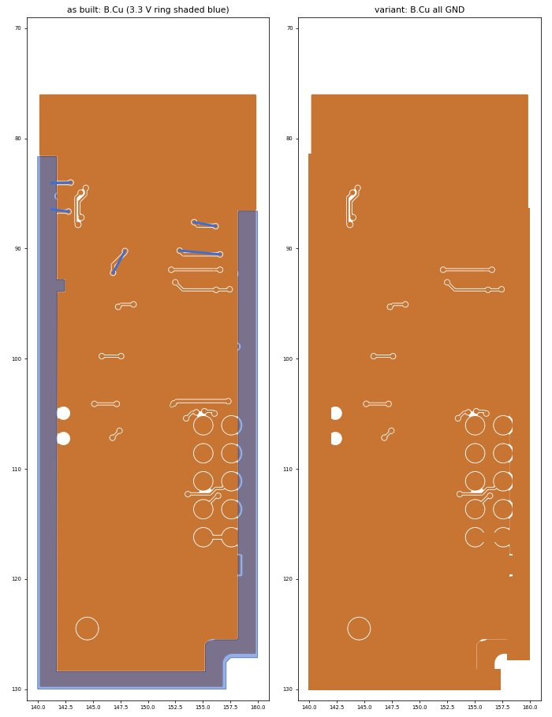

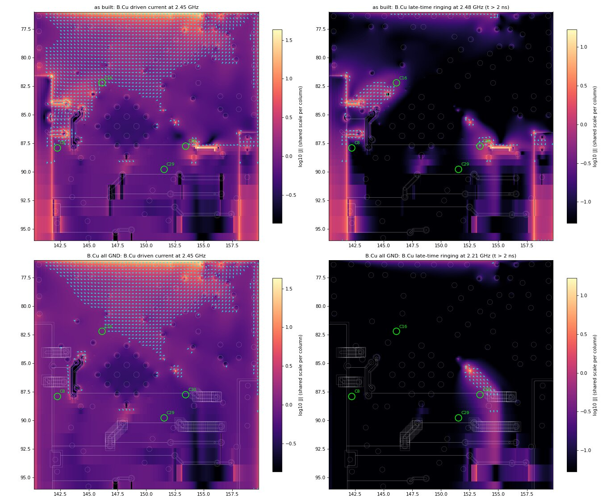

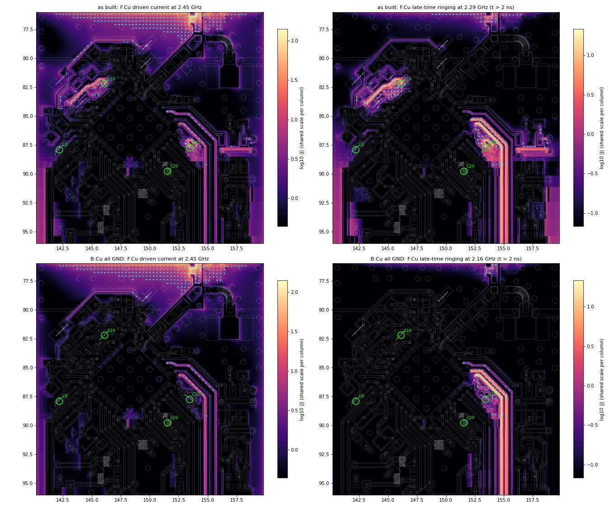

## DEC5 against Nordic's layout

DEC5 is pin N24 of the nRF52840. It is the pin next to the antenna pin along that edge of the chip.

- **Fitting.**
  - **Nordic's DK (PCA10056):** C9 on DEC5 was 820 pF up to DK 2.0.1, and is "N.C., not mounted" from
    2.1.0 onwards (2.1.0, 3.0.0-3.0.3). Nordic's reference layout keeps the C9 footprint.
  - **MTH R7A:** the footprint is C23. The KiCad conversion values it at 100 pF, but the production BOM
    doesn't fit it.
  - So MTH leaves DEC5 unfitted, as the current DK does. Check Nordic's product specification or errata
    for whether the change depends on silicon revision.
- **Placement.**
  - **MTH:** DEC5 leaves the 45°-rotated chip as a 0.15 mm track, about 1.6 mm long, to C23's empty pad.
    That stub runs about 0.9 mm (centre to centre) from C59's antenna-side pad, right at the RF pin.
  - **DK:** C9 sits 2.4 mm out from the chip edge, on the far side of the chip's centre line from the RF
    trace, about 3.3 mm from it.
  - With C23 unfitted, the MTH stub is a small floating piece of copper beside the antenna node. Fitted,
    its ground return would land right next to the RF pin.
- **The BOM also leaves out C6 (DEC4, 100 pF) and C7 (DEC2, 100 pF).** DEC4 keeps C12 (47 nF) and C15
  (1 µF).

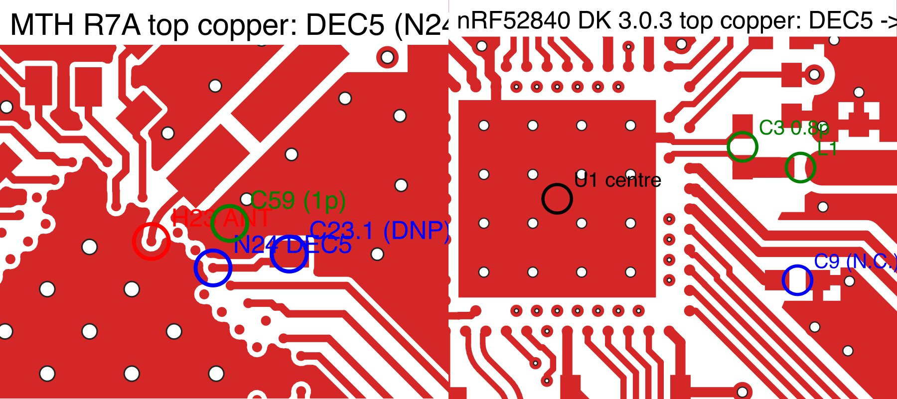

**Effect on the model.** The earlier runs shorted C6, C7 and C23 as decoupling. Rerunning with only the
fitted parts shorted (DEC2 and DEC5 then get the 3 pF pin load) changes little:

- antenna efficiency within 0.2 points at every frequency, and feed impedance within 0.2 Ω;
- around C6, the top-copper current falls by 15 % driven (2.44 GHz) and by 45 % in the late-time ringing;
- along the DEC5 track, it falls by 6-10 %;
- at C7, C23 and the antenna node (C59), it changes by under 2 %.

The DEC areas carry little current compared with the 3.3 V copper near C16, the antenna feed and the
tracks below the chip.

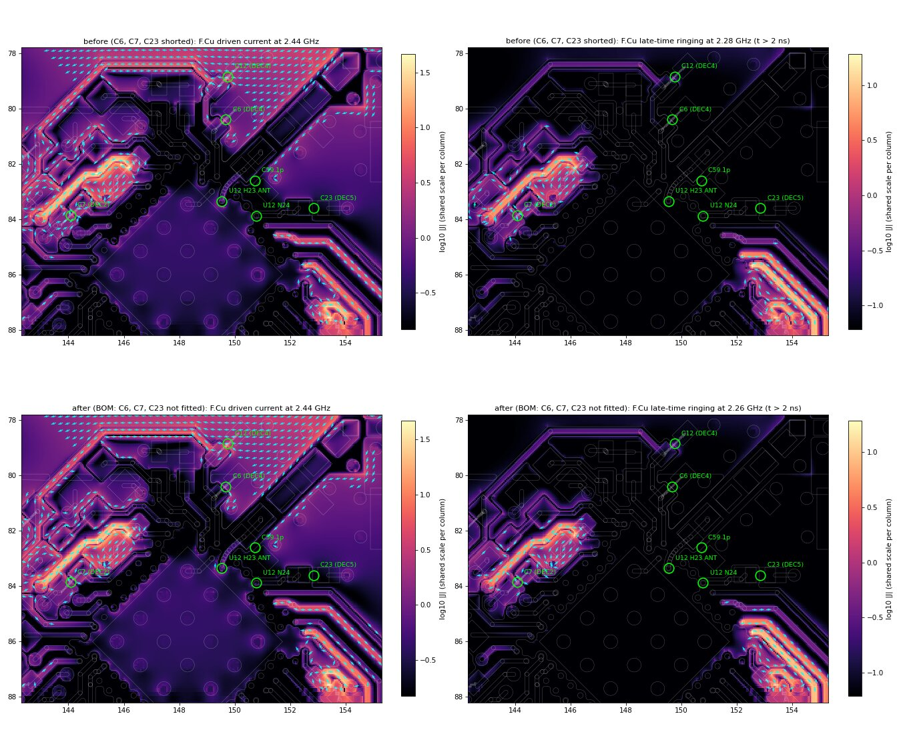

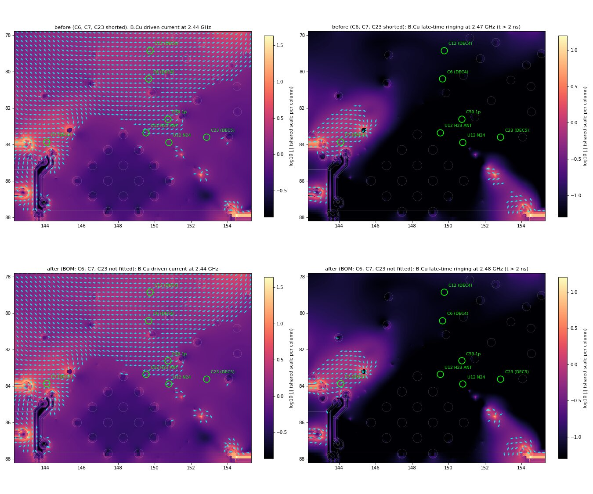

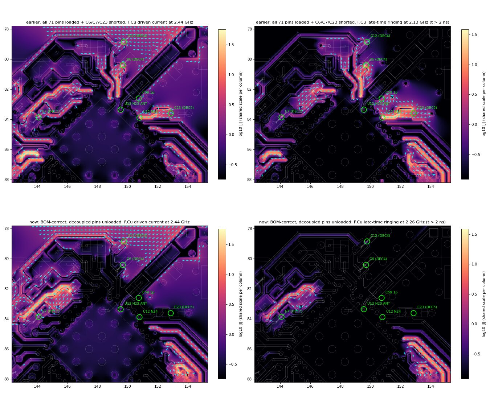

## Superseded results (coarse open end)

From the first EM run, with the fine region starting at x 145 mm, so the antenna's open end was coarse.
Kept for reference only.

| | 2.40 GHz | 2.44 GHz | 2.48 GHz |
|---|---|---|---|
| antenna alone | 37.5 + j5 Ω | 28.5 + j16 Ω | 21.9 + j26 Ω |
| as built, chip sees | 68.5 − j19 Ω | 94 − j21 Ω | 111 − j67 Ω |
| as built, score | −2.0 dB | −3.1 dB | −4.6 dB |
| L5 → 0 Ω, C20 = 0.5 pF (the old recommendation), score | −1.6 dB | −1.4 dB | −1.6 dB |

On that antenna the feed looked inductive (resonance below 2.40 GHz), so removing L5 and adding C20 seemed
to help. That conclusion doesn't hold for the resolved antenna. A provisional version of this note
estimated the correction by swapping the resolved antenna into this run. The direct 7-port run above
replaces it, and it reached the same recommended direction.

## Reproducing

- **EM:** the keys `"edges"` and `"mesh"` are on branch `claude/fieldsolve-refine-octree` (built here at
  61a45cb); without them the run still works, but the results differ (see Caveats). The spec:
  - `"gerbers"` the KiCad conversion's `fabrication/gerbers`, `"coords": "kicad"`, `"extent": "board"`;
  - ROI `[141.5, 70, 159.6, 87.5]`, which must cover all antenna copper; cell 0.05; air 15 mm;
  - `"preset": "antenna"` (wideband loss, surface-impedance copper, edges, mesh refinement, whole
    board). The runs above predate the preset and used `"edges"`, `"mesh"`, `"extent": "board"` and
    `"loss": {"model": "wideband", "copper": true}`, the plane-pair stand-in;
  - `"dielectrics": [{"t": 0.73, "er": 4.5, "tand": 0.015}]`;
  - `"pin_loads": [{"ref": "U12", "c": 3e-12}]` (the nRF52840's pad capacitance; without it, the tracks to
    the chip are open-ended stubs), and far-field frequencies every 0.05 GHz over the band;
  - ports `CHIP` U12.H23→U12.F23, `C59` .2→.1, `L4` .1→.2, `C60` .2→.1, `L5` .1→.2, `R70` .2→.1,
    `C20` .1→.2;
  - decoupling shorts on the fitted capacitors only: C5, C8, C12, C15, C16, C24, C29, C30, C40. The R7A
    BOM leaves out C6 (DEC4), C7 (DEC2) and C23 (DEC5). The runs above before the BOM check also shorted
    those three (see "DEC5 against Nordic's layout");
  - far field at 2.40/2.44/2.48/4.88/7.32 GHz.
- **Cosim:** `keep` `["CHIP"]` with `"target": "nordic_ref_network.s2p"` and `"farfield": true`. For the
  antenna alone, keep `["C20"]` with R70 and CHIP open.
- **Retune:** `EM=<run>/sparams.s7p FIELDSOLVE=<binary> python3 tools/ladder_retune.py 6` (coordinate
  descent over the part libraries, scored as above).
- **Plots:** `tools/polar_farfield.py` and `tools/render_farfield_panels.py`.
